# 
Beyond Nations, previously called the Open Source Game project, started as a collaborative effort between Preponderous Software and the Fairfield Programming Association. It aims to create an open-source game that can serve as a reference for aspiring developers.

## Play in your browser

**[Play Beyond Nations in your browser](https://beyond-nations.play.danielstephenson.dev)**: nothing to install. It is the same game, compiled to WebAssembly and drawn by the same engine, Strata, built for WebGL 2, and it is also listed in the [arcade](https://danielstephenson.dev/play). It plays with a keyboard and mouse, or on a phone or tablet with touch controls: a joystick to walk, a drag to steer, a tap to gather, and big buttons for the rest. The browser build sends no usage report. How it is built, the URL options (`?seed=42&start-screen=world`, the same names as the command-line options) and how to run it locally are in [docs/WEB.md](./docs/WEB.md).

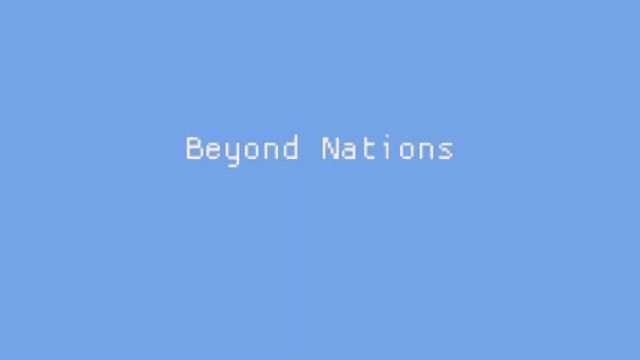

*Recorded from the browser build in headless Chromium, seed 42.*

## Quick Start

The only prerequisite is the [.NET SDK](https://dotnet.microsoft.com/download) 8.0 or newer. There is no editor to install, no account to create and no licence to obtain.

```bash
git clone https://github.com/Preponderous-Software/beyond-nations.git
cd beyond-nations
dotnet run --project src/BeyondNations.Desktop
```

That builds the game and opens it. To run the tests instead:

```bash
dotnet test
```

The game runs on Linux (x64) and Windows (x64). It needs an OpenGL 4.5 capable driver, which Strata, the engine that draws the world, requires; on Linux also the usual X11 or Wayland libraries. **macOS is not supported for now**: Strata has no macOS build (and macOS stops at OpenGL 4.1). The browser build below runs anywhere.

For detailed contribution guidelines, see the [Contributing Guide](./docs/CONTRIBUTING.md). For how the code is laid out, see the [Architecture Note](./docs/ARCHITECTURE.md).

## Project Status & CI
[](https://github.com/Preponderous-Software/beyond-nations/actions/workflows/ci.yml)

This project uses continuous integration to ensure code quality and stability. All pull requests are automatically tested. For more information about the CI pipeline and how to run checks locally, see the [CI/CD Documentation](./docs/CI-CD.md).

## Game Concept
In this game, you'll be able to embark on an adventure in a procedurally generated world filled with resources, settlements and pawns.

You'll be able to collect resources and use them to found settlements, build structures or craft items. You will have the option to join an existing nation or create your own. There will be differences between nations and they will be able to form relations with other nations, whether those be positive or negative. Interacting with the world will be a key activity of the game. Most entities will be interactable. Pawns will have different traits and will be able to interact with each other, the player & the world.

As a leader, you'll be able to manage your nation's relations with other nations, manage your nation's resources, and manage your nation's settlements. As a citizen, you'll be able to contribute to your nation's economy by collecting resources, crafting items and participating in trade.

## Game Features
The following features are planned for the game:
- Procedurally generated world
- Settlements
- Nations
- Pawns
- Resources
- Crafting
- Trade
- Relations
- Quests
- Story
- Combat
- Player customization
- Modding support


## Controls
The following controls are available in the game:
---
| Key | Action |
| --- | --- |
| `W` / `Up Arrow` | Move forward |
| `A` / `Left Arrow` | Turn left |
| `S` / `Down Arrow` | Move backward |
| `D` / `Right Arrow` | Turn right |
| `E` | Interact with nearest entity (talk to a pawn in reach) |
| `G` | Give the pawn in reach a gift (food if it is hungry, otherwise coins, food, wood or stone) |
| `R` | Invite the pawn in reach into your nation |
| `Space` | Jump |
| `Left Shift` | Sprint |
| `N` | Create a new nation |
| `J` | Join a random nation |
| `L` | Leave your current nation |
| `F` | Found a settlement |
| `P` | Plant a sapling |
| `H` | Teleport to home settlement |
| `B` | Build stall |
| `K` | Build the building your settlement needs most (house, storehouse, farm or workshop; costs wood and stone) |
| `I` | Open / close the inventory screen (pauses the world) |
| `O` | Open / close the nations screen: every nation, its size and its relation to yours; a leader can send tribute, propose an alliance, declare war or offer peace, or denounce from here, and set the nation's laws on its *Laws* tab (pauses the world; *Realm* on a touch screen) |
| `C` | Open / close the crafting screen (axe, pickaxe, cooked meat, planks, bricks; pauses the world) |
| `Insert` | Toggle auto-walk |
| `V` | Switch between the third-person and first-person view |
| `Y` | Cycle the chronicle: recent entries (top of the screen) → full scrollable history → hidden |
| Era box (top left; click or tap) | Open / close what the next era needs, what it unlocks and how close each victory is |
| `Right Mouse Button` (hold) + move the mouse | Steer: left/right turns you (W then walks that way), up/down tilts the camera |
| `Page Up` | Increase render distance |
| `Page Down` | Decrease render distance |
| `Escape` | Pause / unpause; close the inventory, nations or crafting screen; back out of a menu; quit from the main menu |
| `?` (`/` key) | Show every control (also the **? Controls** button on the HUD, pause screen and main menu) |
| `F1` | Toggle debug mode (and the debug menu) |
| `F2` | Generate nearby land *(debug mode only)* |
| `F3` | Spawn a new pawn *(debug mode only)* |
| `F4` | Spawn money *(debug mode only)* |
| `F5` | Spawn wood *(debug mode only)* |
| `F6` | Teleport all pawns to you *(debug mode only)* |
| `F12` | Take screenshot |

*(debug mode only)* keys do nothing until debug mode has been enabled with `F1`.

## Game Systems
A number of systems combine to create the gameplay experience. Some are already implemented and some are still planned; the [Systems Document](./docs/SYSTEMS.md) lists each one with its current status.

### Settlements that grow
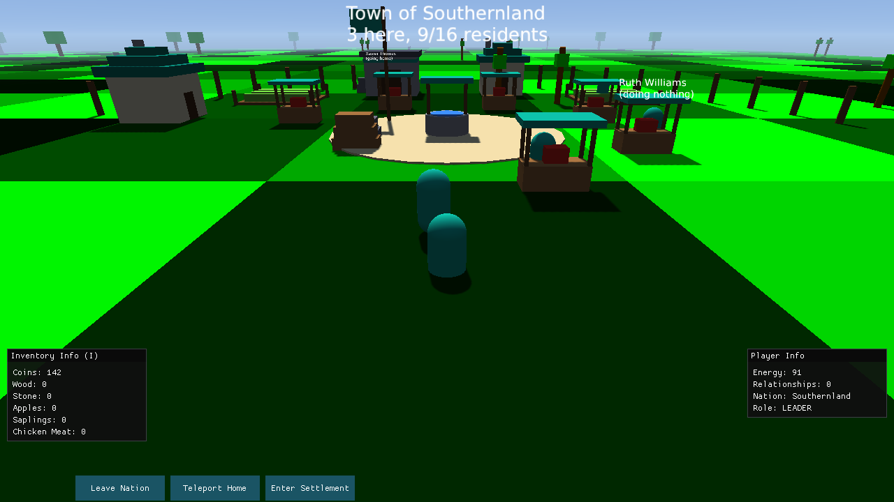

A settlement is drawn as a place: a plaza with a well and the nation's banner, its market stalls in a ring around it (an owned stall has a nation-coloured awning and a crate of whatever it sells; a stall for sale has a pale awning and a yellow sign), and its buildings in a wider ring beyond. Pawns inside a settlement stay visible and mill about the plaza, so a busy town looks busy.

Buildings cost wood **and stone**, so quarrying matters. Press `K` inside one of your nation's settlements to build whatever it needs most, or pick one from the command bar; the cost comes from what you carry first and then from the settlement's stockpile. Leader pawns build too once their market is full.

| Building | Cost | Effect |
| --- | --- | --- |
| House | 20 wood, 15 stone | Room for 4 more residents (a settlement starts with room for 8) |
| Storehouse | 10 wood, 30 stone | 2 more market stalls |
| Farm | 25 wood, 10 stone | One apple every 500 ticks, stocked into a merchant's stall (double in autumn, none in winter) |
| Workshop | 15 wood, 10 stone | Lets anyone inside craft planks and bricks |

Two buildings make a camp a **Village**; five make it a **Town**, which is ringed by a palisade. The tier is on the settlement's nametag. `--stage-settlement` opens the game with a town already standing ahead of the player (the screenshot above is `--seed 42 --start-screen world --stage-settlement`).

### Eras, victory and the end of a run


A run has an arc. Your nation advances **Camp → Village → Town → Kingdom**, one era at a time, and each era asks for more and gives something concrete:

| To leave | Needs | The next era unlocks |
| --- | --- | --- |
| Camp | a village (2 buildings), 5 members, a market stall | the workshop (planks and bricks); up to 3 settlements |
| Village | a town (5 buildings), 12 members, 2 settlements, 500 funds | the storehouse (more stalls); up to 6 settlements |
| Town | 2 towns, 25 members, 4 settlements, 2,000 funds | any number of settlements, and the Prosperity victory |

A camp may build houses and farms and hold one settlement. The objectives follow: after the opening steps the ambitions are set by the era you are in, and the last asks you to win. The era box at the top left of the HUD shows your era and how near the next one is; click or tap it for the details.

Win by **Dominion** (from the Town era, hold more than half of every settlement in the world, at least six), **Prosperity** (in the Kingdom era, 6,000 funds and 40 members) or **Concord** (from the Town era, be allied with every nation still standing). Lose if the nation you built collapses: no settlement and nobody but you, for five minutes. Either way the end-of-run screen tells the story -- the outcome, the era reached, the days survived and your numbers, then *The History of* your nation, drawn from the chronicle -- and offers to **Continue playing** (after a victory), start a **New world** or go to the **Main menu**. `--stage-victory` and `--stage-defeat` open on it (the screenshot above is `--seed 42 --start-screen world --stage-victory`; the one below is `--stage-defeat` at phone size).

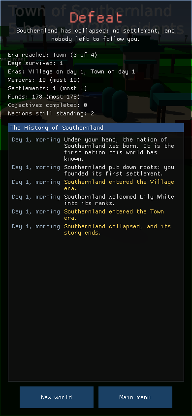

### Nations that deal with each other
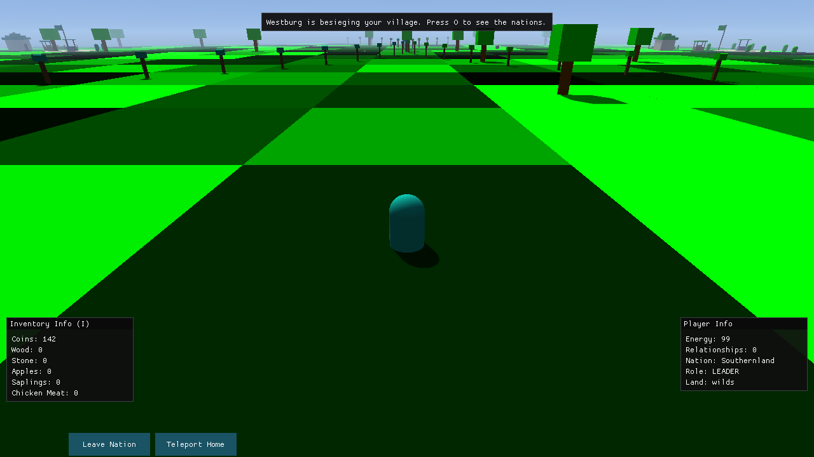

Every settlement claims the land around it: 70 units for a camp, 100 for a village, 130 for a town. Claims never overlap; where two would, the border is drawn where they meet. Each claim is ringed by short posts capped in its nation's colour, the player box says whose land you are in, and crossing a border says so on the status line. Nobody may found a settlement inside another nation's claim, and founding one near another nation's land is resented.

Every pair of nations has a standing from -100 to +100: **Hostile** (-50 and below), **Rival** (-20), **Neutral**, **Friendly** (+20) and **Allied**. Neighbours rub each other the wrong way, faster where their borders touch; allies warm; two nations with a common enemy draw together; trading at another nation's market helps a little, and poaching its members with an invitation hurts. Pawn-led nations make their own choices: they ally once relations reach +40, pay tribute to a hostile neighbour twice their strength, and denounce weaker nations they despise.

Hostility has stakes. A stronger hostile neighbour raids your nearest settlement's treasury and stockpile, and one at least twice as strong (counting its allies' members) lays siege to it; thirty seconds of siege and the settlement changes hands. Towns, behind their palisades, cannot be besieged. A nation left with no settlement falls, and its members are left without one.

As a leader you deal with other nations from the nations screen (`O`) or from the command bar while standing in their land, and every answer comes with its reason:

- **Tribute** of 25 coins (+10, paid into their treasury). Paid to a stronger nation you are at war or at odds with, it also buys a minute's truce: no raids, no sieges.
- **Ally**: accepted at +30, but never by a nation you are at war with, and a nation twice your strength wants +60 before it takes on so small a partner.
- **War**: relations drop to Hostile and stay down while it lasts, any alliance with them breaks, and their allies think less of you. Where your lands meet, the stronger side raids and besieges.
- **Peace** (in place of War once you are at odds): refused when too much blood lies between you (-90 or worse), or by an enemy twice your strength unless a tribute has softened them; accepted, the war ends with a minute's truce and relations at Neutral.
- **Denounce** (-25, and it ends any alliance).

`--stage-diplomacy` opens the game leading a nation between a friendly neighbour and a hostile one already besieging your village (the screenshot above is `--seed 42 --start-screen world --stage-diplomacy`).

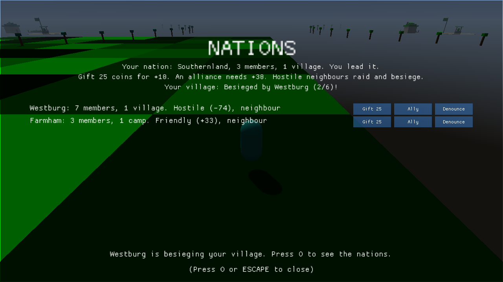

### Ruling a nation
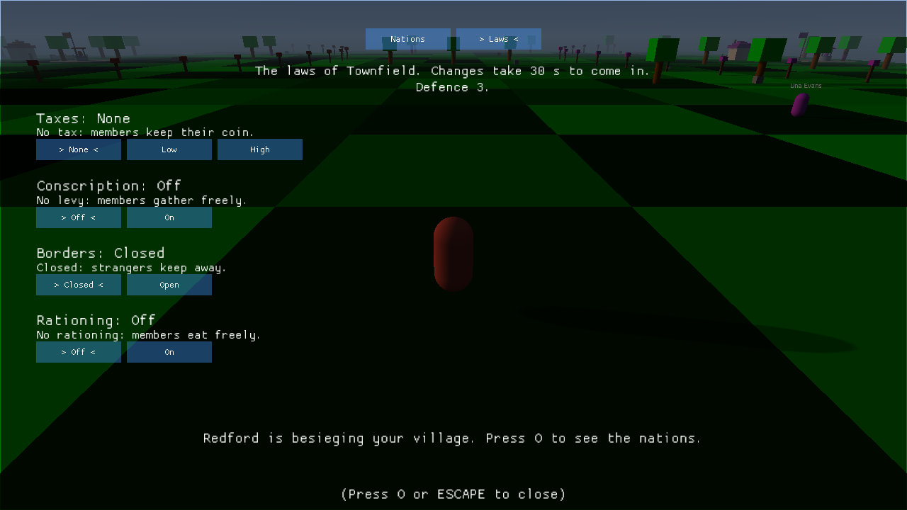

The nations screen's **Laws** tab is your court. A change is proclaimed and comes in thirty seconds later, with a line in the chronicle:

| Law | Buys | Costs |
| --- | --- | --- |
| Taxes (None / Low / High) | 1 or 3 coins from every member into the treasury every 10 seconds | Loyalty: a point every 30 seconds (Low) or every 10 (High); immigrants come half as often (Low) or not at all (High) |
| Conscription | One conscript per two members defends against raids and sieges | Members gather 40% less wood and stone |
| Open borders | Immigrants twice as often, 2 coins of tolls per settlement, trade warms every nation you are not at war with | Raiders carry off double; thieves take coins and wood every 30 seconds |
| Rationing | Members' hunger drains a quarter slower | Morale: a point of loyalty every 20 seconds |

Loyalty is how each member feels about you. Push someone to -15 and they desert, taking their stall with them.

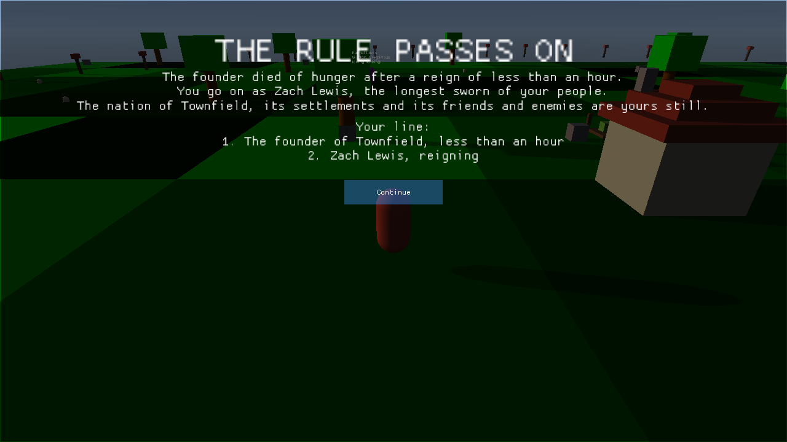

**Heirs.** Dying in a nation is not the end. A member takes your place -- family first (someone who shares your surname), then the most loyal -- and you go on as them, with the nation, its settlements and its friends and enemies as they were; your people's loyalty starts at half what it was. With no one left to take your place, your line ends and so does the run: *New World*, *Load* (the last save, from before the death; an ended run is never saved) or *Main Menu*. A wanderer with no nation still rises again as before. `--stage-succession` opens the diplomacy stage with the player about to starve (the screenshot above is `--seed 42 --start-screen world --stage-succession`; `--start-screen laws` opens on the Laws tab).

### Seasons and regions


The year turns: **spring**, **summer**, **autumn** and **winter**, two in-game days each, so a year is about 80 minutes of play. Spring and summer are easy and chickens hatch; in autumn farms yield double, and it is time to lay in food, because in **winter** farms yield nothing, saplings grow slowly, and the cold makes you (and every pawn) burn energy faster outdoors. Pawns lay in food from autumn and keep closer to home in winter. The ground and the leaves change colour with the season, and the Season box (above the player box) shows the season, warns *Winter in 2 days*, and names the land you stand on.

The land itself differs. The world is made of **regions** in patches several chunks wide: **forest** (plenty of wood, little stone), **highlands** (rich in stone, poor in food), **plains** (good farming and game) and the scarce **moor**. Every region has some stone, so a settlement outside the highlands is short of it rather than stuck, but nations do differ in what they have plenty of and what they lack, which is what trade and diplomacy will be built on. `--season winter` (or `?season=winter` in the browser) opens the game on the first day of that season; the screenshot above is `--seed 42 --start-screen world --season NAME --time-of-day 0.45`.

### World events
Runs diverge. About every ten to fifteen minutes of play something happens that needs a decision: a drought dries up your farms, a fever breaks out in a crowded settlement, wanderers ask to join, bandits camp outside a village and rob it every minute, a claimant to a rival nation's leadership comes looking for backing, a storehouse catches fire, the harvest comes in heavy, a lost traveller offers a map to a spot rich in stone, or a merchant offers tools for a fraction of their price. A sheet rises from the bottom of the screen with two or three choices and what each will cost and bring; the world waits while you decide, and a choice you cannot afford is shown greyed out with the reason. Tap or click a choice. What happened, and what you chose, goes into the chronicle.

Nations led by pawns meet the same events every few minutes, and their leaders choose for them -- so a neighbour may be weakened by sickness, grow by taking in wanderers, or have its leader overthrown by a claimant, and you read about it in the chronicle. `--stage-event` opens with an event already waiting (with `--stage-diplomacy`, one for your nation).

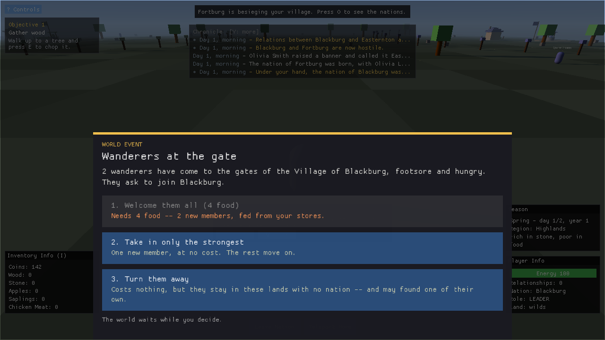

### Crafting
Press `C` (or *Craft* on a touch screen) to open the crafting screen. Each recipe shows its cost, what it is good for, and what you are still missing; tap or click a ready one to make it.

| Recipe | Inputs | Why make it |
| --- | --- | --- |
| Axe | 4 wood, 2 stone | +3 wood from every tree, for 20 trees |
| Pickaxe | 3 wood, 3 stone | +2 stone from every rock, for 15 rocks |
| Cooked Meat | 1 chicken meat, 1 wood | 45 energy instead of raw meat's 25 |
| Planks x2 | 3 wood, in a settlement with a Workshop | Sell for more than the wood |
| Bricks x2 | 3 stone, 1 wood, in a settlement with a Workshop | Sell for more than the stone |

Tools wear out, so keep some wood and stone for the next one. Merchants craft too: their stalls stock tools you can buy, cooked meat, and (with a workshop) planks and bricks. The full rules are in the [Systems Document](./docs/SYSTEMS.md#crafting).

### Sound, feedback and the first five minutes
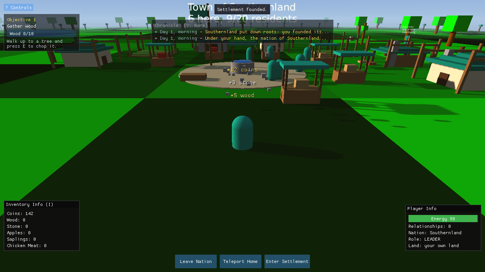

Gathering and building answer back. Chopping a tree throws wood chips and leaves, mining a rock throws stone flakes, and every gain floats up over you ("+5 stone", "+12 coins"; a spend floats down in red). A new building rises out of the ground inside a wooden scaffold, finishing an objective flashes the screen gold, and a raid on your nation shakes the camera.

In the browser every action has a sound: chop, mine, pickup, craft, a building finished, coins, a hunger warning, a hit (hunting, or a raid), interface clicks and objective fanfares, over an ambient loop of wind and birdsong by day and crickets by night. All of it is synthesised as it plays, so the game ships no audio files. Sound starts with your first key press or tap (browsers allow nothing sooner). *Volume*, *Mute Sound* and *Show Tips* are on the config screen, and *Sound: On/Off* is in the corner of the pause screen. The desktop build is silent for now: Strata has no audio and the desktop takes on no audio dependency.

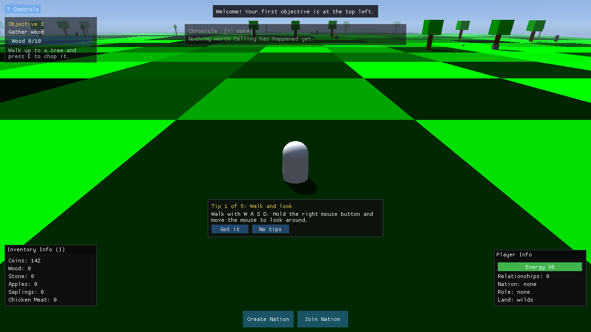

A new world opens with five short tips, one at a time: walk and look, chop a tree, gather stone, found a settlement, and where your goals are. Each goes away as soon as you have done it, *Got it* dismisses it, and *No tips* turns them all off. A tip you have finished is never shown again, in that world or the next (*Show Tips* on the config screen starts them over). On a phone they talk about the pad and the *Use* button instead of keys. 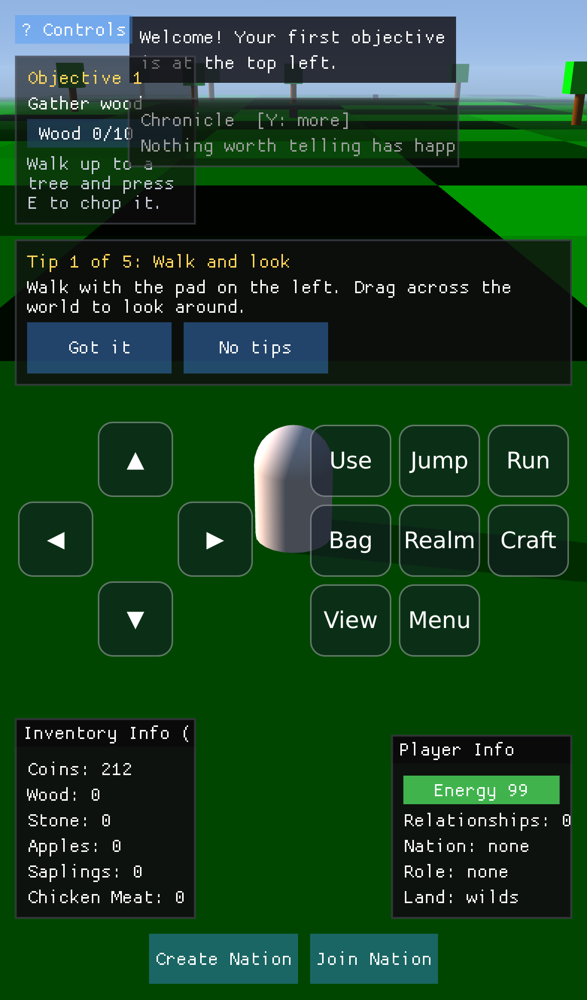 `--stage-feel` replays the effects every 20 frames for screenshots (the image above is `--seed 42 --start-screen world --stage-settlement --stage-feel`).

### Trade caravans and living prices
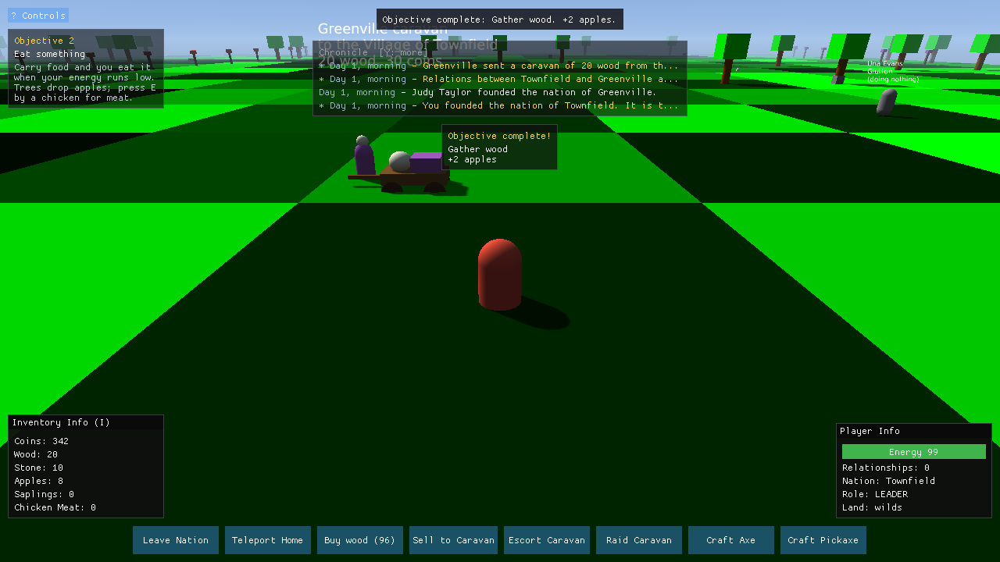

Every market prices its goods by what it has and who lives there. Prices fall as stalls fill up, and drift, a few points every ten seconds, toward what the settlement needs: a crowded town with an empty larder pays well over the odds for food, a camp sitting on a woodpile pays little for more wood. The market box (inside a settlement) lists what each good costs to buy and what a stall pays for one, with an arrow for which way it is moving. Buy where it is cheap, carry it, sell where it is dear. A sale is always priced as the unit lands on the stall, so buying something and selling it straight back never makes money.

Nations led by pawns send **caravans**: a cart in the nation's colours carries what one of their settlements can spare to a dearer market within 1,200 units, never to a nation they are at war with (Hostile), and comes home with the takings. Standing beside one, the command bar lets you **buy** its goods (at the price it expects at market), **sell** it what it deals in, **escort** it (stay close until it arrives for a share of its takings and +8 with its nation) or **raid** it (everything it carries is yours, but its nation loses 30 with yours, which can mean war; without a nation, its people think less of you).

Lead a nation and stand in one of its settlements with a **Storehouse**, and *Send Caravan* opens a panel to pick a market and load goods from what you carry; the takings go into the settlement's treasury. `--stage-trade` opens the game beside a passing caravan, leading a village that can send its own (the screenshots are `--seed 42 --start-screen world --stage-trade`).


## Saving and loading
Worlds are saved, on the desktop and in the browser. The game autosaves every couple of minutes of play and whenever you leave the world (*Main Menu* or *Quit* on the pause screen, or closing the window); *Save* on the pause screen saves at once and says so. On the main menu, *Continue* picks up the latest world and *Load* lists every saved world with its day, your nation and when it was saved.

Saves live in `~/.local/share/BeyondNations/Saves` on Linux, `%AppData%\BeyondNations\Saves` on Windows, and the browser's local storage on the web. Each save is checksummed and the one before it is kept as a backup; a damaged save falls back to its backup, and a save from a newer version is refused rather than overwritten. A loaded world is the same world, down to its random numbers: it plays on exactly as it would have without the save. `--continue` opens the latest save and `--no-saves` turns saving off for a run. The format, versioning and migration policy are in [docs/SAVES.md](./docs/SAVES.md).

## Sharing a world
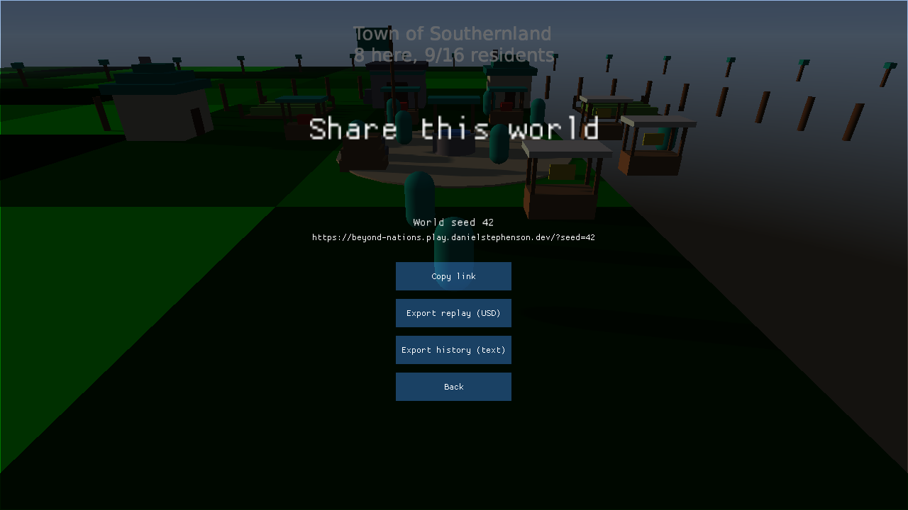

The same seed always builds the same world. *Start* opens the **New World** screen. Type a seed there (a number, or any word: `Ironvale` is always seed 1450162717), press *Random seed* for a fresh one, or leave it empty, then press *Begin*. The pause screen shows the world's seed. *Share* on the pause screen opens a screen with three actions:

- **Copy link** puts `https://beyond-nations.play.danielstephenson.dev/?seed=…` on the clipboard. On a phone, the button is *Share link* and opens the system share sheet. Anyone who opens the link starts the same world.
- **Export replay (USD)** saves the run so far as a `usd-replay/1` replay (`.usda`) that [usd-web](https://github.com/Preponderous-Software/usd-web)'s player can show.
- **Export history (text)** saves the chronicle as "The History of <your nation>" in Markdown.

On the desktop, exports go to `~/.local/share/BeyondNations/Exports` (`%AppData%\BeyondNations\Exports` on Windows). In the browser, they download. `--seed` and `?seed=` take a word as well as a number. How to view a replay, and what is in each file, is in [docs/SHARING.md](./docs/SHARING.md).

## History film
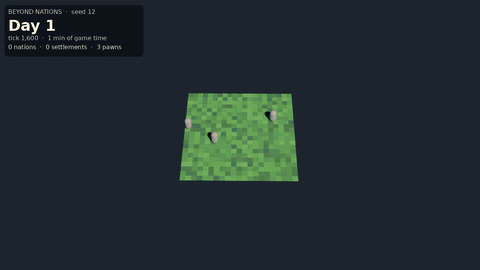

*Seed 12, twenty in-game days (600,000 ticks) in 25 seconds: six nations rise one after another, each tinting the land its settlements recruit from. Rendered from the recorded USD stage in headless Blender.*

A seeded world can be run with no window, recorded tick by tick and turned into a film. The clip above is seed 12 over 600,000 ticks (twenty days of Core's `TimeOfDay`, about 3 hours 20 minutes of play at 50 ticks per second), one frame per 800 ticks: six nations are founded one after another, each nation's colour spreads over the ground its settlements would recruit from, and pawns (drawn larger than life) take their nation's colour when they join.

```bash
# 1. Record: JSON Lines of entities, nations and events (deterministic per seed)
dotnet run --project tools/BeyondNations.HistoryExport -c Release -- \
    --seed 12 --ticks 600000 --every 200 --out out/history.jsonl

# 2. Convert to a time-sampled OpenUSD stage (usd-recorder), chunked and flattened
uv run --python 3.12 tools/history-to-usd.py out/history.jsonl out/usd/history.usda \
    --stride 800 --chunk-size 200 --flatten

# 3. Render an orbit in headless Blender, then overlay the counters and encode
blender -b --threads 4 --python tools/history-film/render.py -- \
    out/usd/history_flat.usdc out/frames --engine cycles --samples 16
uv run --python 3.12 tools/history-film/finish.py out/usd/history_flat.usdc out/frames out/film
```

`tools/history-film/make-film.sh` runs all of it. What is recorded:

- **Time**: the tick and Core's day (`TimeOfDay.getDay()`) on every frame; the overlay shows both.
- **Entities**: every entity's kind, position, nation, home settlement and appearance (primitive, offset, scale, colour) from `EntityRepository`. Core's `EntityId` is a fresh `Guid` each run, so the exporter numbers entities and nations itself in first-seen order.
- **Events**: nation founded, joined, left and disbanded, pawn spawned and died, from Core's own `EventRepository`; leadership changes and settlement founding are derived by comparing each nation with the previous tick, because Core changes those without an event.
- **Territory** in the film is not a Core concept. A tile takes the colour of the nation whose settlement is nearest, if that settlement is within `settlementJoinRange`: the rule a pawn uses when it decides which nation to join.

Same seed, same output: `tools/BeyondNations.HistoryExport.Tests` checks byte-identical exports. Core measures time in ticks rather than on the wall clock (the pawn behaviour cadence and sapling growth, #272), so a headless run of a seed matches the windowed game at the same ticks per second.

### Replay in a browser
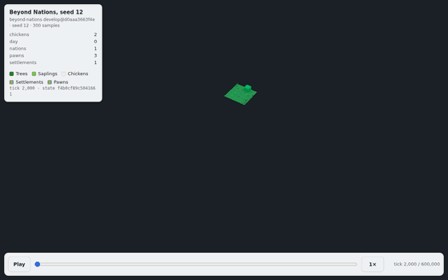

*The same seed 12 history as a 300-sample replay in [usd-web](https://github.com/Preponderous-Software/usd-web)'s player: an 11.5 MB `.usdc`, a 0.93 MB web replay. The panel shows the counters and the state hash of each sample.*

The history can also be turned into a shareable replay in usd-recorder's [`usd-replay/1`](https://github.com/Preponderous-Software/usd-recorder/blob/v0.2.0/docs/REPLAY.md) contract, which any player of that contract can show: pawns and settlements in their nation's colour, chickens, trees and saplings, the ground (with territory) as a colour grid that changes when settlements do, and the day, pawn, settlement and nation counts.

```bash
uv run --python 3.12 tools/history-to-replay.py out/history.jsonl out/seed12.usdc --stride 2000
uvx --from "usd-recorder @ git+https://github.com/Preponderous-Software/usd-recorder@v0.2.0" \
    usd-recorder replay validate out/seed12.usdc
uvx --from "usd-web @ git+https://github.com/Preponderous-Software/usd-web@v0.2.0" \
    usd-web replay out/seed12.usdc -o site/replay      # then serve usd-web's viewer/replay.html
```

Core keeps no state hash of its own, so each sample's `replay:stateHash` is a SHA-256 of the exported state (every entity's id, kind, nation, position and visibility, and the nation table): it proves the export is reproducible, which the CI job below checks by exporting twice. The converter only reads the export; the game is not involved.

## Tech Stack
- [C#](https://docs.microsoft.com/en-us/dotnet/csharp/) on [.NET 8](https://dotnet.microsoft.com/): the whole game, simulation and host alike.
- [Silk.NET](https://github.com/dotnet/Silk.NET): windowing, the OpenGL context and input, maintained under the `dotnet` organisation.
- [Dear ImGui](https://github.com/ImGuiNET/ImGui.NET): the menus, the heads-up display and the info boxes.
- [FontStashSharp](https://github.com/FontStashSharp/FontStashSharp): the glyph atlas behind world-space nametags.
- [Strata](https://github.com/Preponderous-Software/strata): a shared C++ engine (MIT) and the game's world renderer. It draws the world inside the Silk.NET window, lit by a sun that follows the time of day (see below). The build downloads the native library from a pinned Strata release and checks its SHA-256. Pass `/p:StrataNativeDir=<dir>` to use a local Strata build instead.
- [WebAssembly and WebGL2](./docs/WEB.md): the browser build, `src/BeyondNations.Web` (.NET 8 `browser-wasm`, AOT), which runs the same Core and screens in a page, with the world drawn by Strata's WebGL 2 build linked into it.
- [Git](https://git-scm.com/) and [GitHub](https://github.com/): version control, review and continuous integration.

The game does not use a commercial engine. Everything it draws is a coloured primitive generated in code; the renderer is Strata, a small engine from the same organisation, and the camera, input and user interface are written in the repository rather than supplied by a vendor. The reasoning is recorded in the [Engine Migration Rationale](./docs/ENGINE-MIGRATION-RATIONALE.md).

Third-party assets and their licences are listed in [THIRD-PARTY.md](./docs/THIRD-PARTY.md).

### Rendering with Strata

The world is drawn by Strata, and only by Strata. Strata lights it with a sun
and a moon that follow the simulation's time of day (`TimeOfDay` in Core,
derived from the tick count; one day is 30,000 ticks, which is ten minutes at
the default 50 ticks per second), and adds cascaded shadows, hemisphere
ambient light, fog and an analytic sky. `--time-of-day F` starts a world at a
chosen time: 0.25 is sunrise, 0.5 noon and 0.75 sunset. The F1 overlay shows
the current time and day. (The old managed Silk.NET world renderer, the
`--renderer` switch, `--native-lighting` and the parity check between the two
renderers have been removed. Silk.NET still provides the window, the GL
context, input and the ImGui backend.)

```bash
dotnet run --project src/BeyondNations.Desktop -- --time-of-day 0.3
```

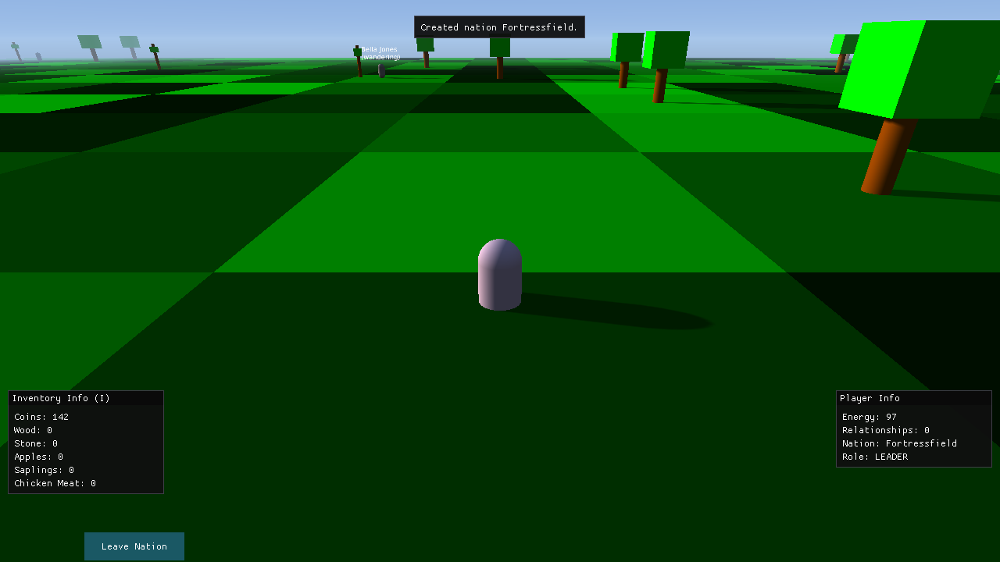

*Seed 42, rendered by Strata on Mesa llvmpipe in a headless run, just after N founded a nation.*

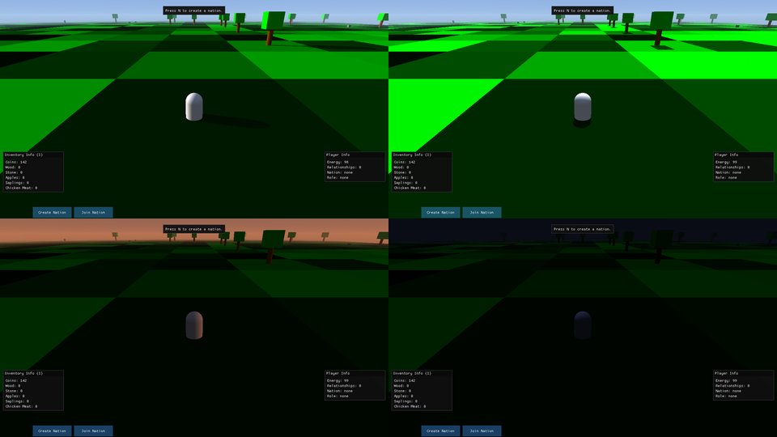

*Time of day 0.3 (morning), 0.5 (noon), 0.74 (sunset) and 0.95 (night, by moonlight).*

## Inspirations
### Medieval Factions
Medieval Factions is a Minecraft plugin that enables players to create their own nation, claim territory, and form relations with other nations. The plugin is limited because it is designed for a game that is not created for this kind of gameplay. The objective of our project is to develop a game specifically designed for this kind of gameplay.

### Mount & Blade: Warband
Mount & Blade: Warband is a medieval action role-playing game that features a sandbox gameplay style. The game allows players to create their own character and choose which faction to join. Players can also create their own faction and conquer territories. The game features a variety of gameplay elements such as combat, diplomacy, and trade. The game is a great source of inspiration for our project because it features many of the gameplay elements that we want to implement in our game.

### Minecraft
Minecraft is a sandbox video game that allows players to explore a procedurally generated world, gather resources, craft items, and build structures. The game features a variety of gameplay elements such as combat, exploration, and resource gathering. The game is a great source of inspiration for our project because it features many of the gameplay elements that we want to implement in our game.

## Usage reporting
Usage reporting is on by default: each time the game starts, Beyond Nations sends its name (`beyond-nations`), its version and a random installation ID in one `startup` event to [trace](https://github.com/Stephenson-Software/trace) at `https://trace.danielstephenson.dev`. Nothing about you, your machine, your world or anything you do in the game is sent. (The trace server sees the IP address of the request, as every web server does.)

The installation ID is a random UUID, made on the first run with reporting on and kept in a file named `trace-install-id` beside `settings.json` (see below). It is not derived from anything about you or your computer; it only lets trace count installations rather than startups. Delete the file to reset it. Setting the environment variable `TRACE_INSTALL_ID` sends that value instead, and the file is left alone. Every way of turning reporting off below also stops the ID: with reporting off, the file is never created, read or sent. The report goes out on a background thread, never holds up the game, and is dropped silently if the service cannot be reached.

The first run creates a `settings.json` in the game's data directory (`~/.local/share/BeyondNations/` on Linux, `%AppData%\BeyondNations\` on Windows) and prints a one-line notice naming it. To turn reporting off, any one of these is enough:

- `"usageReporting": {"enabled": false}` in that `settings.json`:

  ```json
  {
      "usageReporting": {
          "enabled": false
      }
  }
  ```

- the command-line switch `--no-usage-reporting`, for one run
- the environment variable `TRACE_USAGE_REPORTING=off` (also `false`, `0`, `no`), which turns off every program that reports to trace
- the environment variable `DO_NOT_TRACK=1` (see [consoledonottrack.com](https://consoledonottrack.com))

The environment variables win over everything else. When reporting is off, the game says so at startup with the reason. The defaults the game ships with, including the reporting key, are in `src/BeyondNations.Desktop/usage-reporting.json`.

The [browser build](./docs/WEB.md#usage-reporting-off) sends nothing: the reporting code is not part of it.

Details: https://github.com/Stephenson-Software/trace#usage-reporting

## Contributing
To get started contributing to this project, please read the [Contributing Guide](./docs/CONTRIBUTING.md).

## Authors and acknowledgment
### Software Development
Name | Main Contributions
------------ | -------------
Daniel McCoy Stephenson | Creator
Pasarus | Participated in brainstorming sessions & participated in PR reviews

### Other
Name | Main Contributions
------------ | -------------
William McGonagle | Initially reached out to Preponderous Software to collaborate on a unity project, participated in brainstorming sessions
Phil Garner | Participated in brainstorming sessions & provided feedback on economic mechanics
Nathan Gates | Playtested the game & participated in brainstorming sessions
Ezekiel Martinez | Participated in brainstorming sessions
Sshinx | Contributed custom 3D models including trees, saplings & rocks

## 📄 License

This project is licensed under the **Preponderous Non-Commercial License (Preponderous-NC)**.  
It is free to use, modify, and self-host for **non-commercial** purposes, but **commercial use requires a separate license**.

> **Disclaimer:** *Preponderous Software is not a legal entity.*  
> All rights to works published under this license are reserved by the copyright holder, **Daniel McCoy Stephenson**.

Full license text:  
[https://github.com/Preponderous-Software/preponderous-nc-license/blob/main/LICENSE.md](https://github.com/Preponderous-Software/preponderous-nc-license/blob/main/LICENSE.md)
