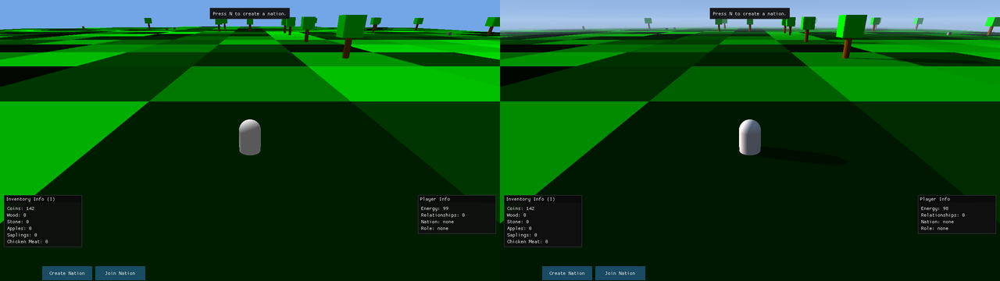

# 
Beyond Nations, previously called the Open Source Game project, started as a collaborative effort between Preponderous Software and the Fairfield Programming Association. It aims to create an open-source game that can serve as a reference for aspiring developers.

## Play in your browser

**[Play Beyond Nations in your browser](https://beyond-nations.play.danielstephenson.dev)**: nothing to install. It is the same game, compiled to WebAssembly and drawn with WebGL2, and it is also listed in the [arcade](https://danielstephenson.dev/play). It is played with a keyboard and mouse; on a phone or tablet there are basic on-screen controls. The browser build sends no usage report. How it is built, the URL options (`?seed=42&start-screen=world`, the same names as the command-line options) and how to run it locally are in [docs/WEB.md](./docs/WEB.md).


*Recorded from the browser build in headless Chromium, seed 42.*

## Quick Start

The only prerequisite is the [.NET SDK](https://dotnet.microsoft.com/download) 8.0 or newer. There is no editor to install, no account to create and no licence to obtain.

```bash
git clone https://github.com/Preponderous-Software/beyond-nations.git
cd beyond-nations
dotnet run --project src/BeyondNations.Desktop
```

That builds the game and opens it. To run the tests instead:

```bash
dotnet test
```

On Linux the game needs an OpenGL 3.3 capable driver and the usual X11 or Wayland libraries, both of which a desktop install already has.

For detailed contribution guidelines, see the [Contributing Guide](./docs/CONTRIBUTING.md). For how the code is laid out, see the [Architecture Note](./docs/ARCHITECTURE.md).

## Project Status & CI
[](https://github.com/Preponderous-Software/beyond-nations/actions/workflows/ci.yml)

This project uses continuous integration to ensure code quality and stability. All pull requests are automatically tested. For more information about the CI pipeline and how to run checks locally, see the [CI/CD Documentation](./docs/CI-CD.md).

## Game Concept
In this game, you'll be able to embark on an adventure in a procedurally generated world filled with resources, settlements and pawns.

You'll be able to collect resources and use them to found settlements, build structures or craft items. You will have the option to join an existing nation or create your own. There will be differences between nations and they will be able to form relations with other nations, whether those be positive or negative. Interacting with the world will be a key activity of the game. Most entities will be interactable. Pawns will have different traits and will be able to interact with each other, the player & the world.

As a leader, you'll be able to manage your nation's relations with other nations, manage your nation's resources, and manage your nation's settlements. As a citizen, you'll be able to contribute to your nation's economy by collecting resources, crafting items and participating in trade.

## Game Features
The following features are planned for the game:
- Procedurally generated world
- Settlements
- Nations
- Pawns
- Resources
- Crafting
- Trade
- Relations
- Quests
- Story
- Combat
- Player customization
- Modding support


## Controls
The following controls are available in the game:
---
| Key | Action |
| --- | --- |
| `W` / `Up Arrow` | Move forward |
| `A` / `Left Arrow` | Turn left |
| `S` / `Down Arrow` | Move backward |
| `D` / `Right Arrow` | Turn right |
| `E` | Interact with nearest entity |
| `Space` | Jump |
| `Left Shift` | Sprint |
| `N` | Create a new nation |
| `J` | Join a random nation |
| `L` | Leave your current nation |
| `F` | Found a settlement |
| `P` | Plant a sapling |
| `H` | Teleport to home settlement |
| `B` | Build stall |
| `I` | Open / close the inventory screen (pauses the world) |
| `Insert` | Toggle auto-walk |
| `V` | Switch between the third-person and first-person view |
| `Right Mouse Button` (hold) + move the mouse | Look around |
| `Page Up` | Increase render distance |
| `Page Down` | Decrease render distance |
| `Escape` | Pause / unpause; close the inventory screen; back out of a menu; quit from the main menu |
| `F1` | Toggle debug mode (and the debug menu) |
| `F2` | Generate nearby land *(debug mode only)* |
| `F3` | Spawn a new pawn *(debug mode only)* |
| `F4` | Spawn money *(debug mode only)* |
| `F5` | Spawn wood *(debug mode only)* |
| `F6` | Teleport all pawns to you *(debug mode only)* |
| `F12` | Take screenshot |

*(debug mode only)* keys do nothing until debug mode has been enabled with `F1`.

## Game Systems
A number of systems combine to create the gameplay experience. Some are already implemented and some are still planned; the [Systems Document](./docs/SYSTEMS.md) lists each one with its current status.

## History film


*Seed 12, twenty in-game days (600,000 ticks) in 25 seconds: six nations rise one after another, each tinting the land its settlements recruit from. Rendered from the recorded USD stage in headless Blender.*

A seeded world can be run with no window, recorded tick by tick and turned into a film. The clip above is seed 12 over 600,000 ticks (twenty days of Core's `TimeOfDay`, about 3 hours 20 minutes of play at 50 ticks per second), one frame per 800 ticks: six nations are founded one after another, each nation's colour spreads over the ground its settlements would recruit from, and pawns (drawn larger than life) take their nation's colour when they join.

```bash
# 1. Record: JSON Lines of entities, nations and events (deterministic per seed)
dotnet run --project tools/BeyondNations.HistoryExport -c Release -- \
    --seed 12 --ticks 600000 --every 200 --out out/history.jsonl

# 2. Convert to a time-sampled OpenUSD stage (usd-recorder), chunked and flattened
uv run --python 3.12 tools/history-to-usd.py out/history.jsonl out/usd/history.usda \
    --stride 800 --chunk-size 200 --flatten

# 3. Render an orbit in headless Blender, then overlay the counters and encode
blender -b --threads 4 --python tools/history-film/render.py -- \
    out/usd/history_flat.usdc out/frames --engine cycles --samples 16
uv run --python 3.12 tools/history-film/finish.py out/usd/history_flat.usdc out/frames out/film
```

`tools/history-film/make-film.sh` runs all of it. What is recorded:

- **Time**: the tick and Core's day (`TimeOfDay.getDay()`) on every frame; the overlay shows both.
- **Entities**: every entity's kind, position, nation, home settlement and appearance (primitive, offset, scale, colour) from `EntityRepository`. Core's `EntityId` is a fresh `Guid` each run, so the exporter numbers entities and nations itself in first-seen order.
- **Events**: nation founded, joined, left and disbanded, pawn spawned and died, from Core's own `EventRepository`; leadership changes and settlement founding are derived by comparing each nation with the previous tick, because Core changes those without an event.
- **Territory** in the film is not a Core concept. A tile takes the colour of the nation whose settlement is nearest, if that settlement is within `settlementJoinRange`: the rule a pawn uses when it decides which nation to join.

Same seed, same output: `tools/BeyondNations.HistoryExport.Tests` checks byte-identical exports. Core measures time in ticks rather than on the wall clock (the pawn behaviour cadence and sapling growth, #272), so a headless run of a seed matches the windowed game at the same ticks per second.

### Replay in a browser


*The same seed 12 history as a 300-sample replay in [usd-web](https://github.com/Preponderous-Software/usd-web)'s player: an 11.5 MB `.usdc`, a 0.93 MB web replay. The panel shows the counters and the state hash of each sample.*

The history can also be turned into a shareable replay in usd-recorder's [`usd-replay/1`](https://github.com/Preponderous-Software/usd-recorder/blob/v0.2.0/docs/REPLAY.md) contract, which any player of that contract can show: pawns and settlements in their nation's colour, chickens, trees and saplings, the ground (with territory) as a colour grid that changes when settlements do, and the day, pawn, settlement and nation counts.

```bash
uv run --python 3.12 tools/history-to-replay.py out/history.jsonl out/seed12.usdc --stride 2000
uvx --from "usd-recorder @ git+https://github.com/Preponderous-Software/usd-recorder@v0.2.0" \
    usd-recorder replay validate out/seed12.usdc
uvx --from "usd-web @ git+https://github.com/Preponderous-Software/usd-web@v0.2.0" \
    usd-web replay out/seed12.usdc -o site/replay      # then serve usd-web's viewer/replay.html
```

Core keeps no state hash of its own, so each sample's `replay:stateHash` is a SHA-256 of the exported state (every entity's id, kind, nation, position and visibility, and the nation table): it proves the export is reproducible, which the CI job below checks by exporting twice. The converter only reads the export; the game is not involved.

## Tech Stack
- [C#](https://docs.microsoft.com/en-us/dotnet/csharp/) on [.NET 8](https://dotnet.microsoft.com/): the whole game, simulation and host alike.
- [Silk.NET](https://github.com/dotnet/Silk.NET): windowing, OpenGL and input, maintained under the `dotnet` organisation.
- [Dear ImGui](https://github.com/ImGuiNET/ImGui.NET): the menus, the heads-up display and the info boxes.
- [FontStashSharp](https://github.com/FontStashSharp/FontStashSharp): the glyph atlas behind world-space nametags.
- [Strata](https://github.com/Preponderous-Software/strata): a shared C++ engine (MIT) that the game is moving onto in phases. Today it is an opt-in renderer, `--renderer native`, which draws the same world inside the Silk.NET window, lit by a sun that follows the time of day (see below). `--renderer silk` is the default. The build downloads the native library from a pinned Strata release and checks its SHA-256. Pass `/p:StrataNativeDir=<dir>` to use a local Strata build instead.
- [WebAssembly and WebGL2](./docs/WEB.md): the browser build, `src/BeyondNations.Web` (.NET 8 `browser-wasm`, AOT), which runs the same Core and screens with a WebGL2 port of the default renderer.
- [Git](https://git-scm.com/) and [GitHub](https://github.com/): version control, review and continuous integration.

The game does not use a commercial engine. Everything it draws is a coloured primitive generated in code, so the renderer, camera, input and user interface are written in the repository rather than supplied by a vendor. The reasoning is recorded in the [Engine Migration Rationale](./docs/ENGINE-MIGRATION-RATIONALE.md).

Third-party assets and their licences are listed in [THIRD-PARTY.md](./docs/THIRD-PARTY.md).

### The native renderer

`--renderer native` draws the world through Strata. By default it lights the
world with Strata's sun and moon, which follow the simulation's time of day
(`TimeOfDay` in Core, derived from the tick count; one day is 30,000 ticks,
which is ten minutes at the default 50 ticks per second). Strata also adds
cascaded shadows, hemisphere ambient light, fog and an analytic sky.
`--native-lighting legacy` asks for the Silk renderer's fixed light instead.
That is what the CI parity job compares. `--time-of-day F` starts a world at a
chosen time: 0.25 is sunrise, 0.5 noon and 0.75 sunset. The F1 overlay shows
the current time and day.

```bash
dotnet run --project src/BeyondNations.Desktop -- --renderer native --time-of-day 0.3
```



*Seed 42. Left: `--renderer silk`, the default. Right: `--renderer native` in the mid-morning sun, with the player's shadow and Strata's sky.*


*`--renderer native` at time of day 0.3 (morning), 0.5 (noon), 0.74 (sunset) and 0.95 (night, by moonlight).*

## Inspirations
### Medieval Factions
Medieval Factions is a Minecraft plugin that enables players to create their own nation, claim territory, and form relations with other nations. The plugin is limited because it is designed for a game that is not created for this kind of gameplay. The objective of our project is to develop a game specifically designed for this kind of gameplay.

### Mount & Blade: Warband
Mount & Blade: Warband is a medieval action role-playing game that features a sandbox gameplay style. The game allows players to create their own character and choose which faction to join. Players can also create their own faction and conquer territories. The game features a variety of gameplay elements such as combat, diplomacy, and trade. The game is a great source of inspiration for our project because it features many of the gameplay elements that we want to implement in our game.

### Minecraft
Minecraft is a sandbox video game that allows players to explore a procedurally generated world, gather resources, craft items, and build structures. The game features a variety of gameplay elements such as combat, exploration, and resource gathering. The game is a great source of inspiration for our project because it features many of the gameplay elements that we want to implement in our game.

## Usage reporting
Usage reporting is on by default: each time the game starts, Beyond Nations sends its name (`beyond-nations`), its version and a random installation ID in one `startup` event to [trace](https://github.com/Stephenson-Software/trace) at `https://trace.danielstephenson.dev`. Nothing about you, your machine, your world or anything you do in the game is sent. (The trace server sees the IP address of the request, as every web server does.)

The installation ID is a random UUID, made on the first run with reporting on and kept in a file named `trace-install-id` beside `settings.json` (see below). It is not derived from anything about you or your computer; it only lets trace count installations rather than startups. Delete the file to reset it. Setting the environment variable `TRACE_INSTALL_ID` sends that value instead, and the file is left alone. Every way of turning reporting off below also stops the ID: with reporting off, the file is never created, read or sent. The report goes out on a background thread, never holds up the game, and is dropped silently if the service cannot be reached.

The first run creates a `settings.json` in the game's data directory (`~/.local/share/BeyondNations/` on Linux, `%AppData%\BeyondNations\` on Windows) and prints a one-line notice naming it. To turn reporting off, any one of these is enough:

- `"usageReporting": {"enabled": false}` in that `settings.json`:

  ```json
  {
      "usageReporting": {
          "enabled": false
      }
  }
  ```

- the command-line switch `--no-usage-reporting`, for one run
- the environment variable `TRACE_USAGE_REPORTING=off` (also `false`, `0`, `no`), which turns off every program that reports to trace
- the environment variable `DO_NOT_TRACK=1` (see [consoledonottrack.com](https://consoledonottrack.com))

The environment variables win over everything else. When reporting is off, the game says so at startup with the reason. The defaults the game ships with, including the reporting key, are in `src/BeyondNations.Desktop/usage-reporting.json`.

The [browser build](./docs/WEB.md#usage-reporting-off) sends nothing: the reporting code is not part of it.

Details: https://github.com/Stephenson-Software/trace#usage-reporting

## Contributing
To get started contributing to this project, please read the [Contributing Guide](./docs/CONTRIBUTING.md).

## Authors and acknowledgment
### Software Development
Name | Main Contributions
------------ | -------------
Daniel McCoy Stephenson | Creator
Pasarus | Participated in brainstorming sessions & participated in PR reviews

### Other
Name | Main Contributions
------------ | -------------
William McGonagle | Initially reached out to Preponderous Software to collaborate on a unity project, participated in brainstorming sessions
Phil Garner | Participated in brainstorming sessions & provided feedback on economic mechanics
Nathan Gates | Playtested the game & participated in brainstorming sessions
Ezekiel Martinez | Participated in brainstorming sessions
Sshinx | Contributed custom 3D models including trees, saplings & rocks

## 📄 License

This project is licensed under the **Preponderous Non-Commercial License (Preponderous-NC)**.  
It is free to use, modify, and self-host for **non-commercial** purposes, but **commercial use requires a separate license**.

> **Disclaimer:** *Preponderous Software is not a legal entity.*  
> All rights to works published under this license are reserved by the copyright holder, **Daniel McCoy Stephenson**.

Full license text:  
[https://github.com/Preponderous-Software/preponderous-nc-license/blob/main/LICENSE.md](https://github.com/Preponderous-Software/preponderous-nc-license/blob/main/LICENSE.md)
