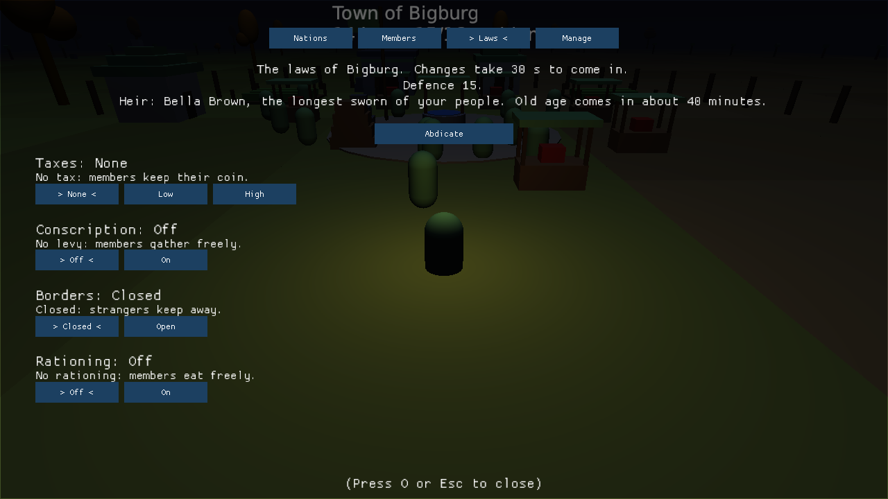

# Contributing Guide

## Getting Started

The only prerequisite is the [.NET SDK](https://dotnet.microsoft.com/download) 8.0 or newer.

```bash
git clone https://github.com/Preponderous-Software/beyond-nations
cd beyond-nations
dotnet build
dotnet test
dotnet run --project src/BeyondNations.Desktop
```

`dotnet build` and `dotnet test` need nothing but the SDK. `dotnet run` additionally needs an OpenGL 4.5 capable driver (Strata, the world renderer, requires it), on Linux or Windows x64; macOS is not supported for now.

### Useful switches

The game takes arguments that make it checkable without a person watching it, which is how the automated checks and most manual verification work:

| Switch | Effect |
| --- | --- |
| `--exit-after-frames N` | render N frames, then exit |
| `--start-screen NAME` | open on `title`, `main-menu`, `config`, `world`, `pause`, `inventory`, `controls`, `nations`, `laws` (the nations screen on its Laws tab), `members` (the nations screen on its Members tab), `manage` (the nations screen on its Manage tab), `settlement` (the settlement screen, on the settlement the player is in or nearest to), `crafting`, `load`, `new-world` (the seed for a new world) or `share` (the world's seed, share link and exports) |
| `--ui-scale F` | draw the UI F times its design size, 1 to 4; by default the monitor's content scale (150 % in Windows display settings is 1.5) |
| `--seed S` | fix the world seed, so a run is reproducible: a number, or any text, which is hashed to one (see [SHARING.md](./SHARING.md)) |
| `--screenshot-after-frames N` | write a PNG and carry on |
| `--lockstep N` | run exactly N ticks every frame, ignoring the wall clock; on by default (N = 1) with `--screenshot-after-frames` (with or without a `--stage-*` flag; staged play without a screenshot follows the clock), so a staged shot shows the same scene for the same seed and frame count on a loaded machine; `--lockstep 0` follows the clock as normal play does |
| `--render-stats` | report draw calls, instance counts and frame times on exit |
| `--render-distance N` | start at this render distance; 0 keeps the configured one |
| `--no-culling` | submit every primitive, culling nothing, to measure what culling saves |
| `--no-labels` | draw no world-space nametags |
| `--smoke-resize` | resize the window part-way through, to exercise resize handling |
| `--width N`, `--height N` | window size (default 1280 × 720) |
| `--ticks-per-second N` | simulation rate, independent of frame rate (default 50) |
| `--no-vsync` | do not wait for vertical sync |
| `--debug-mode` | open with the F1 overlay already on |
| `--first-person` | open in first person, which `V` otherwise toggles |
| `--no-usage-reporting` | send no usage report this run (see *Usage reporting* in the README) |
| `--no-saves` | neither autosave, save on quit nor offer saved worlds this run, so an automated run leaves a player's saves alone (see [SAVES.md](./SAVES.md)) |
| `--continue` | open in the most recently saved world, as **Continue** on the main menu does; falls back to the main menu when there is none |
| `--stage-settlement` | open with a lived-in settlement (nation, market, merchants, residents) standing ahead of the player |
| `--stage-journal [TAB[:N]]` | open on the Journal over the world, on its Goals tab or the one named (`goals`, `chronicle`, `era`, `inventory`, `nation`); `:N` opens the N-th tile's card. Pair it with `--stage-outpost --advance-ticks 3000` for a lived-in nation |
| `--stage-holdings` | as `--stage-outpost` (a Village-era nation with two settlements), with the newer settlement given to a member and the player standing outside it |
| `--stage-diplomacy` | open leading a nation between a friendly and a hostile, besieging neighbour, standing at the border |
| `--stage-succession` | as `--stage-diplomacy`, with the player about to starve, so the first tick hands the rule to an heir and opens the succession screen |
| `--stage-event` | open with a world event's choice sheet up (with `--stage-diplomacy`, wanderers at your village) |
| `--stage-trade` | open leading a village that can send caravans, beside a trading neighbour's caravan on the road ahead |
| `--stage-feel` | replay the feedback effects (chips, floating "+5 wood", buildings rising, the objective flash) every couple of seconds, for screenshots |
| `--stage-victory`, `--stage-defeat` | open on the end-of-run screen of a staged run: a Prosperity victory in the Kingdom era, or a collapse |
| `--playtest-out DIR` | write `state.json` (what is on screen, about twice a second) and `events.jsonl` (what happened) to DIR, for playtesting agents (see [PLAYTESTING.md](./PLAYTESTING.md)) |
| `--advance-ticks N` | run the world N ticks before the first frame, as fast as it goes, so it opens mid-game. The player sits the fast-forward out: they are kept fed meanwhile and come in at full energy, and their reign starts when they do, so old age is as far off as in a new world (`--season` likewise; #490) |
| `--flyover-out DIR` | hide the UI, glide the camera from one nation's town across the border to a neighbour's, write every frame to DIR as a PNG and exit after `--flyover-frames N` (default 120); the README's flyover is the `flyover` shot in `tools/capture/media.json` |
| `--flyover-orbit` | with `--flyover-out`, circle the thickest stand of trees near the player once instead (give `--advance-ticks` so the land round the player is generated); the README's tree GIF is `--seed 12 --advance-ticks 50` |
| `--time-of-day F` | start the world at this time of day, at least 0 and below 1 (0.25 sunrise, 0.5 noon, 0.75 sunset; default 0.3) |
| `--season NAME` | start on the first day of `spring`, `summer`, `autumn` or `winter` (default spring) |
| `--help`, `-h` | list every switch |

A fast-forwarded start is the player's fresh start (#490). Before, `--season autumn --advance-ticks 22000` with `--stage-settlement` counted the skipped days as the founder's reign (left, "Old age comes in about 3 minutes"); now the reign starts when the player does (right, "about 40 minutes", as in a new world):

 

### Troubleshooting

- **`dotnet: command not found`** — install the .NET SDK 8.0 or newer.
- **The window does not open over SSH** — the game needs a display. On a headless machine, run it under a virtual framebuffer such as `Xvfb`, or use `--exit-after-frames` to check it starts without needing to see it.
- **`Unable to load shared library 'cimgui'`** — the bundled Dear ImGui native library needs a reasonably current C library. The version pinned here works on Ubuntu 20.04 and newer; if you have changed the `ImGui.NET` version, check that first.

## Layout

```
src/BeyondNations.Core/      the simulation. No graphics, no engine, no packages.
src/BeyondNations.Desktop/   the host: window, renderer, camera, input, UI, usage reporting.
src/BeyondNations.Web/       the browser host (see WEB.md).
tests/BeyondNations.Core.Tests/
tests/BeyondNations.Desktop.Tests/
tests/BeyondNations.Web.Tests/
tools/                       the history exporter and its tests, the history-to-USD and replay scripts, and the history film.
docs/
```

The split is the most important convention in the project and is explained in the [Architecture Note](./ARCHITECTURE.md). The short version: **`BeyondNations.Core` must never reference a game engine, a graphics API, or a window.** A continuous integration job fails the build if it does.

If you are unsure which project your change belongs in, ask whether it could be tested with no window open. If yes, it belongs in core.

## Conventions

- Target framework is **net8.0**.
- Methods are `camelCase`, matching the existing code, rather than the usual .NET `PascalCase`. Consistency with the surrounding code wins.
- Four-space indentation, opening brace on the same line.
- The repository has been formatted with [csharpier](https://csharpier.com/) in the past; the tool manifest is in `.config/dotnet-tools.json`. Restore it with `dotnet tool restore` if you want it.
- Prefer a plain class that can be constructed in a test over one that needs a graphics context.

## Tests

Tests are [xUnit](https://xunit.net/), under `tests/`, mirroring the structure of the code they cover.

```bash
dotnet test                                        # everything
dotnet test tests/BeyondNations.Core.Tests         # the simulation only
```

Write tests for what you change. Two things are worth knowing:

- **Assertions must be able to fail.** The suite this replaced used a Unity call that only wrote a note when something was wrong, so it could not fail a build and did not for years. Use `Assert.Equal`, `Assert.True` and friends, which stop the run.
- **Randomness is injected and seedable.** Construct a `RandomSource` with a fixed seed in a test rather than relying on a default, and world generation will produce the same world every time.

## Branching

The model is close to Git Flow. `main` holds the latest stable version. `develop` holds the latest development version and is what pull requests target.

## Pull Requests

1. Branch from `develop`.
2. Make your changes, with tests.
3. Run `dotnet build` and `dotnet test` locally.
4. Push and open a pull request against `develop`.
5. Wait for review. The automated checks must pass before it can be merged.

### Running the checks locally

The checks are the same two commands the pipeline runs, so there is nothing special to reproduce:

```bash
dotnet build BeyondNations.sln --configuration Release
dotnet test  BeyondNations.sln --configuration Release
```

And the guards on the core boundary, both of which should print nothing:

```bash
grep -rn --include='*.cs' -E '^[[:space:]]*using[[:space:]]+UnityEngine' src/BeyondNations.Core
grep -rn --include='*.cs' -E '\[(DllImport|LibraryImport)|NativeLibrary\.|StrataNative|using[[:space:]]+Strata' src/BeyondNations.Core
```

See the [CI/CD Documentation](./CI-CD.md) for what the pipeline does with them.

### Refreshing the README's screenshots and GIFs

The README's flyover, seasons, town, Journal, nation, settlement screen, members, Laws tab, market panel and winter images are a shot list, `tools/capture/media.json`, for [darkroom](https://github.com/Preponderous-Software/darkroom). Each shot runs the real game with the switches above on its own virtual display and turns what it writes into a JPEG, or for the flyover a GIF, an MP4 and a poster still, each fitted under a size budget. The seasons are one run per season (`"each"`), composed into a captioned 2x2 grid. Linux only (it needs `Xvfb`, `apt install xvfb`); about five minutes in all, most of it the flyover's 150,000 ticks.

```bash
pip install "darkroom[video] @ git+https://github.com/Preponderous-Software/darkroom"
dotnet build src/BeyondNations.Desktop -c Release
darkroom shoot tools/capture/media.json                        # everything that is out of date
darkroom shoot tools/capture/media.json --only flyover --force # one shot again
darkroom gallery tools/capture/media.json --insert README.md   # put each image at its marker in the README
```

Each shot's `"file"` is the path the README already links (`.github/media/flyover.gif`, `.github/media/seasons.jpg`, ...), so a reshoot replaces the old image in place. In the README every image sits between `<!-- darkroom:shot NAME -->` and `<!-- darkroom:end -->`; `darkroom gallery --insert README.md` rewrites just those blocks (image, alt text and caption, all from the shot list), so to change an image's alt text or caption, edit `media.json` and run it again. For a PR body, which lives outside the repository, add `--base-url https://raw.githubusercontent.com/Preponderous-Software/beyond-nations/<branch>/` so the links resolve anywhere.

The flags every shot shares (`--no-saves`, `--no-usage-reporting`, the window size) are the list var `common`, spliced into the default `argv` as `"@common"`; each shot's `"argv+"` adds its own seed, start screen and stage. The game runs in a scratch directory darkroom makes per run and deletes afterwards (so its `imgui.ini` and logs never land in the repository), with `XDG_DATA_HOME` pointing its data folder into the run's output folder, which is where its screenshots are collected from.

The market panel has no flag that opens it, so its shot runs the game through `tools/capture/click-shot.sh`, which clicks *Trade at Market*, a good and *Sell* with `xdotool` as a player would, waits until the game's `--playtest-out` state lists the panel, and grabs the window with ImageMagick's `import` (so it also needs `apt install xdotool imagemagick`). Its click points are the 1280x720 layout's; if the command bar or the panel moves, update them in `media.json`.

darkroom keeps each take's raw frames in `tools/capture/.darkroom/` (ignored by git), so `darkroom shoot tools/capture/media.json --encode --only flyover` re-encodes the last take without running the game again. darkroom starts Xvfb with Mesa's software renderer (`LIBGL_ALWAYS_SOFTWARE=1`, `GALLIUM_DRIVER=llvmpipe`) for both the display and the game, which is what keeps it working on machines whose GPU driver crashes Xvfb, such as NVIDIA under WSL.

### Shooting the browser build on a phone and a desktop

`tools/capture/web.json` is a second shot list, for darkroom's `web` backend: it opens the browser build in headless Chromium as a phone held upright (`phone`, 390x844 at DPR 3 with touch, so the game's touch layout comes up as on a real phone), a phone on its side (`landscape`, 844x390) and a desktop (`desktop`, 1280x720), and stills every screen a touch player reaches: the title, New World, a new world with its first tip and command bar, the controls list, the nations screen's Nations, Members, Laws and Manage tabs, the settlement screen, a market town's command bar and (upright and on the desktop) the market panel. Each screen is reached with the URL options of [WEB.md](./WEB.md#url-options) (`start-screen`, `stage-diplomacy`, `stage-market`), one page load each; the market panel is a tap on *Trade at Market*. Two more shots, `phone-staged` and `desktop-staged`, still a lived-in town (`stage-settlement`), a nation with two settlements (`stage-outpost`) and the warning the day before winter (`stage-settlement&season=autumn&advance-ticks=22000`, which waits for `status().advancing` to reach 0; the live build needs a release that has these options). The stills land in `docs/screenshots/web-phone-shotlist/` as `<device>-<screen>.jpg`.

It shoots the live arcade build by default. Point `base` at a local publish (see [WEB.md](./WEB.md#building)) to shoot your own:

```bash
cd src/BeyondNations.Web/smoke && npm ci && npx playwright install chromium && cd -
export NODE_PATH=$PWD/src/BeyondNations.Web/smoke/node_modules   # darkroom's web backend needs Playwright
darkroom shoot tools/capture/web.json                                          # the live build
darkroom shoot tools/capture/web.json --only phone --force                     # one device again
darkroom shoot tools/capture/web.json --var base=http://localhost:8080/ --out /tmp/web-shots   # a local build, to a scratch folder
```

Headless Chromium draws WebGL with SwiftShader at a few frames a second (DPR 3 is nine times the pixels), and every screen boots the .NET runtime again, so a device takes 10 to 20 minutes; the waits are long on purpose. The three devices can be shot in parallel (`--only phone`, `--only landscape`, `--only desktop` in separate shells). The tap coordinates for the rotate hint's OK and for *Trade at Market* are in the shot's `comment`; if the HUD moves, look at `phone-market-town.jpg` and update them. darkroom records console errors with each take (`tools/capture/.darkroom/takes/<device>/meta.json`).

## Issues

If you find a bug or want a feature, open an issue describing it. Bug reports are more useful with the seed (`--seed`) and the switches you ran with, since that makes the world reproducible.
