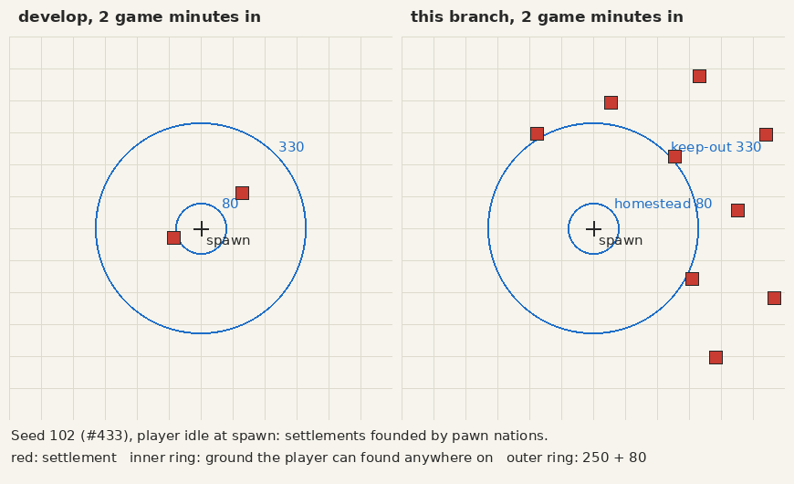

# Pacing

How long each objective takes is measured, not guessed. `tools/BeyondNations.Pacing` drives the Core simulation with no window and a scripted player, records when each objective completes on several seeds, and checks the times against a budget checked in at [`pacing-budget.json`](./pacing-budget.json). CI runs it on every push and pull request (see [CI-CD.md](./CI-CD.md)).

## The bot

`PacingBot` plays like a person who reads the objective hints:

- It works on the current objective and nothing else, pressing one key at a time and at most five a second.
- It walks to things (sprinting, turning to face them) and never teleports. Gifts, conversations and market sales are at most one a second, the speed at which someone can read the reply.
- It only runs the Core commands that the keys and HUD buttons run (`InteractCommand`, `NationCreateCommand`, `FoundSettlementCommand`, `BuildStallCommand`, `SellResourcesAtMarketCommand`, `GiftPawnCommand`, `InvitePawnToNationCommand`, `GiftNationCommand`, and `WorldEvents.choose` for a world event's sheet). It never uses a debug command.
- It recruits nationless settlers first. They join at Acquaintance, as the hint says. Only when there are none left anywhere does it court another nation's members who neither lead it nor are Loyal by nature. Those need Loyal standing, and poaching them sours relations. It sticks with one settler for up to two minutes while that settler is out of doors.
- It answers a world event's choice sheet a second after it comes up, with the first choice it can take that costs no coins, since it keeps its coins for gifts (drive the bandits off, dig ditches, welcome the wanderers; `PacingBot.chooseWorldEventAnswer`), through `WorldEvents.choose`, the sheet's buttons. A person cannot play on past the sheet (the host pauses the world), so the bot does not either; it used to leave every sheet to its three-minute timeout and default.
- When a siege warning tells it to "Gift, ally or grow it", it sends the besieger a gift if it can afford one. If it loses its nation anyway, it founds a new one and starts again.

The bot reads the objective list generically. Ids it knows get a specific plan. Any other objective is planned from the label on its progress counter (`Wood`, `Stone`, `Members`, `Settlements`, `Funds`, `Day`), and anything else gets general play. The harness takes the objectives from `ObjectiveTracker.getObjectives()` and `getCompletedCount()`, so a reworked objective list is still measured, and it reports objectives it has no budget for instead of crashing.

A run is deterministic: the same seed gives the same times on every run and every machine, and the seeds run in parallel without changing a result.

## What is measured

For every objective on every seed:

- **time**: seconds of game time from the previous objective's completion (or the start of the world) to this one's. This is the number the budget checks.
- **completion time**: total ticks, game time and in-game day when it completed.

And, every 30 seconds of game time, the curves: nations alive, pawns alive, the player's nation's members and settlements, the player's coins, funds (coins plus the nation's treasuries), wood and stone, objectives completed, and what the bot was doing.

And, over the whole run, how many times the player's nation was raided (and how many an hour) and how many raids it made (a **Raids** table; `raidsOnPlayer`, `raidsOnPlayerPerHour`, `raidsByPlayer` in the JSON).

The report goes to `pacing-out/pacing-report.md` (readable, with one curve row per minute) and `pacing-out/pacing-report.json` (everything). In CI it is the job summary of **Build and test** and the `pacing-report` artifact.

## Running it locally

```bash
export PATH=/root/.dotnet:$PATH   # wherever your .NET 8 SDK is
dotnet run --project tools/BeyondNations.Pacing -c Release -- --check
```

That runs the seeds, objective limit and tick cap in the budget file, writes the report to `pacing-out/`, and exits 1 if any objective is out of budget. Options:

| Option | Meaning |
|---|---|
| `--budget FILE` | the budget to read (default `docs/pacing-budget.json`) |
| `--seeds 1,2,3` | other seeds |
| `--objectives N` | stop each run after N objectives |
| `--max-ticks N` | stop each run after N ticks |
| `--out DIR` | where the report goes (default `pacing-out`) |
| `--check` | exit 1 on a failure |
| `--write-budget` | rewrite the budget file from these runs |
| `--trace` | print every status line the bot's player sees, with its time, one seed at a time |

`--trace` is the way to find out why an objective is slow: it shows what the bot was doing and what the game told it.

## The budget

Each entry in `docs/pacing-budget.json` gives an objective's `id`, its `title` (for people reading it), `minSeconds` and `maxSeconds`, and optionally a `note` and `advisory`. The file also sets the `seeds`, `objectiveLimit` (how many objectives a run plays) and `maxTicks` (when a run gives up).

A run **fails** the check when an objective:

- finishes in **less** than `minSeconds`. A minimum states a design intent: it is the time below which the player did not really do anything for the objective. A teaching step that is one key press has a minimum of 0.
- finishes in **more** than `maxSeconds`;
- **never** finishes before the run ends.

It only **warns** when:

- the objective has no budget entry, which is what happens when someone adds or renames objectives;
- a budget entry is never reached (it was renamed or removed, or a run stopped before it);
- the entry is `advisory`: it is reported as too fast, too slow or never, but does not fail the build. Use this for objectives that are still being balanced.

### Updating the budget

When you change pacing on purpose (a cost, a target, a new objective):

1. Run `dotnet run --project tools/BeyondNations.Pacing -c Release -- --write-budget`. It sets each maximum to twice the slowest time plus a minute, and each minimum to half the fastest time, keeping a hand-set minimum that is lower. It keeps `advisory` and `note` and marks new ambitions as advisory.
2. Read the diff. The minimums in particular are design decisions, not measurements, so set them to what the objective should take, not what it happens to take now.
3. Run `--check`, and commit the budget with the change that needed it, saying why in the pull request.

A failing check is a real result. Before you widen a budget, read the report and a `--trace` and decide whether the game or the budget is wrong.

## Measured timings (seeds 1 to 5)

Seconds of game time per objective, at 50 ticks a second and 30 000 ticks (10 minutes) a day:

| Objective | seed 1 | seed 2 | seed 3 | seed 4 | seed 5 | budget |
|---|---|---|---|---|---|---|
| Gather wood | 3 | 3 | 2 | 2 | 2 | 0 – 120 |
| Eat something | 1 | 1 | 1 | 1 | 1 | 0 – 60 |
| Create or join a nation | 1 | 1 | 1 | 1 | 1 | 0 – 60 |
| Found a settlement | 3 | 7 | 6 | 3 | 3 | 0 – 180 |
| Enter your settlement | 1 | 1 | 1 | 1 | 1 | 0 – 60 |
| Build a market stall | 7 | 14 | 6 | 6 | 5 | 0 – 120 |
| Reach the Village era | 404 | 393 | 403 | 406 | 407 | 300 – 1800 |
| Sell resources at market | 1 | 12 | 1 | 2 | 11 | 0 – 180 |
| Found a second settlement | 11 | 18 | 20 | 1 | 23 | 0 – 120 |
| Grow your nation to 16 (ambition) | 199 | 120 | 203 | 1 | 125 | 5 – 2400, advisory |
| Amass 1000 coins (ambition) | 238 | 186 | 177 | 33 | 181 | 30 – 3900, advisory |
| Hold 3 settlements (ambition) | 13 | 25 | 24 | 12 | 23 | 0 – 300, advisory |
| Reach the Town era (ambition) | 2538 | 2639 | 2575 | 2951 | 2637 | 0 – 5400, advisory |
| Grow your nation to 25 (ambition) | 1 | 1 | 1 | 1 | 1 | 300 – 3600, advisory |

Measured with eras (Camp to Kingdom, see SYSTEMS.md) and the hungry start (the player begins at 85 energy), on develop with seasons, regions, rulers, world events, trade and spoiling apples, for one hour of game time a seed (`maxTicks` 180 000, 14 objectives). Spoiling apples (SYSTEMS.md, "Seasons") left every binding objective inside its budget and the budget unchanged; the arc to the Village era is unchanged to the second. Among the advisory ambitions, seed 3 now amasses its 1000 coins and goes on to the Town era (it stalled on the coins before), seed 1 now grows to 25, and the Town era takes longer on seed 1 (36 minutes after the previous step, against 24). The arc up to the Village era takes 17 to 20 minutes of game time on seeds 1 to 15. Starving pawns foraging rather than walking home to a market that cannot feed them (SYSTEMS.md, "Seasons") left the binding objectives and the arc to the Village era unchanged; it moved the advisory ambitions a little (seed 3 grows to 16 four minutes later and amasses its coins later, the Town era comes earlier on seeds 3 and 5), and the budget is unchanged. The table was last regenerated on develop with pawn energy capped at a full bar (#340) and Interact acting on what the player faces (below, "Known issues"); the budget is unchanged. It was regenerated again with the Village era at day 2 instead of day 3 (#352, below in "The eras") and the player's nation growing past a full world (#371, below in "Recruiting"): the Village era now comes at 7m 00s on all five seeds (17m 00s before), so the steps after it come ten minutes sooner and the members ambitions, no longer met while the bot waited for day 3, take two to three minutes. The Town era still comes at 57m 00s, its day. Every binding objective is inside its budget and the budget's numbers are unchanged; only the Village era's note was rewritten. "Grow your nation to 25" is met within a second on every seed (advisory, too fast): with #371 the courting bot's nation is well past 25 members by the time that ambition comes up.

### The opening (#351, #370, #433)

Keeping the spawn's trees and the ground around it for the player in the opening (`ReservedGround`), and the first world event within a minute and a half of founding, left every binding objective where it was: on seeds 1 to 5 the steps up to "Build a market stall" take the same seconds as on develop, the Village era is still 17m 00s, and "Sell resources" and "Found a second settlement" moved by at most 20 seconds. The bot does not see the spawn changes, since it founds where it gathers its wood, a few seconds in; they are for a person who reads the tips first. Measured headless instead (`docs/screenshots/early-game-opening/`): on seed 1450162717 the nearest tree to the idle player is 33.5 m away at 1, 40 and 120 seconds, against 165 m at 40 seconds on develop; on seed 102 the nearest settlement to the spawn after two minutes is 339 m off, against 90 m; and a player who founds 20 seconds in meets their first event at 110 seconds, against 557.

The bot now answers each world event's sheet (above) instead of leaving it to its default, because the first event used to come after the arc and now comes in the middle of it: left alone, the bandits' default ("bar the gates") robbed the bot's village every minute for a day and a half. The advisory "Grow your nation to 16" after the Village era is very sensitive to anything that changes who joins whom. On develop it took 21m 48s, 20m 43s, 43m 32s, 17m 03s and 33m 06s on seeds 1 to 5; on develop with only the bot answering events, seed 1 never got there in the hour; with this change seeds 1 and 3 never do and seeds 2, 4 and 5 take 20m 05s, 45m 49s and 41m 41s. That ambition was already the one the harness lists as still being balanced (Known issues), and it stays advisory. The budget is unchanged.

Answering events also brought out a crash: a claimant the player warns against is put out of their nation (`Realm.expel`), and if they were indoors at the time the next behaviour decision dereferenced their missing nation. A nationless pawn inside a settlement now walks out (`PawnBehaviorCalculator`).



### The eras

When each era was reached, in minutes of game time from the start of the world, over four hours a seed (`--objectives 30 --max-ticks 720000 --seeds 1,...,10`):

| Era | 1 | 2 | 3 | 4 | 5 | 6 | 7 | 8 | 9 | 10 | aimed at |
|---|---|---|---|---|---|---|---|---|---|---|---|
| Village | 7.0 | 7.0 | 7.0 | 7.0 | 7.0 | 7.0 | 7.0 | 7.0 | 7.0 | 7.0 | 7 – 15 |
| Town | 57.0 | 57.0 | 57.0 | 57.0 | 57.0 | 57.0 | 57.0 | 57.0 | 57.0 | 57.0 | about 60 |
| Kingdom | 177 | 177 | 177 | 177 | 177 | 177 | 177 | 177 | 177 | 177 | a few hours |
| Prosperity victory | 177 | 177 | 177 | 177 | 177 | 177 | 177 | 177 | 177 | 177 | |

Each era waits for its day as well as its requirements (`EraRules`: day 2, 7 and 19, 7, 57 and 177 minutes in), because settlers flock to a new nation that courts them, and without the calendar most seeds were a village within two or three minutes and a town within ten. The table was measured with the player's nation growing past a full world (#371) and the Village at day 2 (#352). The bot courts every settler, so for it the calendar is the floor on every seed and every era. Before those two changes (Village at day 3, about 17 minutes), the Village came at 17.0 to 19.9 minutes, the Town at 57 to 171, and the Kingdom on 3 of the 10 seeds; where the times ran past the day, the bot was short of members, which #371 fixed. Now the bot also wins: Prosperity (40 members and 6,000 funds in the Kingdom era) comes within a few seconds of the Kingdom on every seed, so the run is decided by the Kingdom's day. Before #371 it never won. These four-hour runs were not repeated with #371 alone, so the victory cannot be credited to one change or the other, though the Village's day does not gate the Town or the Kingdom. For a player who does not court, the Village comes at 7 to 14 minutes ("Recruiting", below). The Village era is binding in the budget again (the calendar means it can no longer be met within a second); the Town and Kingdom eras are advisory.

### Recruiting

The bot courts settlers faster than a person can: it walks straight to the nearest one, never loses it, and gifts once a second. Playtesters at 3 to 17 frames a second could not keep a pawn in reach, and by the time their settlement stood, the AI nations had signed up every nationless settler. `--no-courting` measures the other way to grow: the bot builds its settlement and stalls as usual but never talks to, gifts or invites a pawn, so every member comes from the world (settlers who wander in, newcomers, births). The console line and the JSON (`villageMembersTick`, `membersInvited`, `membersJoinedOtherwise`) say when the nation first had the Village era's 10 members.

`--no-courting --seeds 1,...,10 --objectives 7 --max-ticks 90000` (30 minutes of game time a seed):

| Seed | 1 | 2 | 3 | 4 | 5 | 6 | 7 | 8 | 9 | 10 |
|---|---|---|---|---|---|---|---|---|---|---|
| 10 members, before #371's fix | never (4) | never (5) | never (6) | 8m 00s | never (6) | never (6) | 3m 31s | never (3) | never (6) | never (6) |
| 10 members, after | 10m 01s | 13m 01s | 9m 30s | 8m 00s | 7m 00s | 6m 30s | 3m 31s | 13m 00s | 10m 01s | 7m 30s |

(The number in brackets is the nation's members after 30 minutes.) Before, the world reached its 100-pawn limit within three to six minutes, and a full world drew no newcomer and bore no child, so the nation stopped growing for good; the Village era came on 2 of the 10 seeds. After, the player's nation may grow 20 pawns past the limit (SYSTEMS.md, "Population growth"), it gains a member every minute or two, and the Village era comes at day 3 (17m 00s) on all 10 seeds. The world peaked at 111 pawns. Courting still pays: the bot that courts has 10 members within about two minutes.

With the Village era at day 2 (#352, "The eras"), the same no-courting run reaches the Village era at:

| Seed | 1 | 2 | 3 | 4 | 5 | 6 | 7 | 8 | 9 | 10 |
|---|---|---|---|---|---|---|---|---|---|---|
| 10 members | 9m 31s | 13m 31s | 9m 31s | 8m 00s | 8m 30s | 6m 30s | 3m 31s | 13m 30s | 9m 31s | 9m 30s |
| Village era | 9m 43s | 13m 46s | 9m 45s | 8m 19s | 8m 39s | 7m 00s | 7m 00s | 13m 46s | 9m 38s | 9m 36s |


So on 8 of the 10 seeds the members, not the calendar, decide when the era comes (at day 3 it was 17m 00s on all ten, whatever the player did), and courting, which the bot here never does, would bring it sooner. Seeds 1, 2, 5 and 8 reach 10 members up to 31 seconds later than in the table above, which was measured on an older develop with the era at day 3.

## Known issues the harness found

- **"Grow your nation to 5" used to be met within a second on some seeds.** *It is now "Reach the Village era" (a village, 10 members, 2 stalls and day 2), binding at 300 – 1800 s.* Before seasons and regions (#318), settlers joined a new settlement on their own, and on seed 3 the nation already had five members when the step came up (1 s). The 5 s minimum fails that. On develop with #318 the step takes 18 s to 2 m 24 s, because nations now take up almost every settler in the first two minutes. So the target is unchanged, and the minimum stays to catch a return of the problem.
- **On most seeds a new player's nation was besieged and taken within about ten minutes.** *Addressed by eras: a nation the player leads cannot be besieged until the Town era (`EraRules.isSheltered`; raids still come), and a nation that falls apart for good ends the run as a defeat.* The original finding: By minute two the world has 25 to 45 nations and its full 100 pawns, so few nationless settlers are left to recruit, and Hostile neighbours at least twice the player's strength lay siege. Gifts only buy time. On seed 3 the bot's nation falls at about minute 5. Every nation it founds after that falls within a few minutes, so "Grow your nation to 10" never completes there. Before #318 this happened on four of the five seeds. This is why the ambitions are advisory for now. Make them binding once a new player can hold on.
- **"Amass 500 coins" was usually met when it came up.** The rewards from the arc, the starting purse and the treasuries already add up to more than 500. *Addressed by eras: the funds ambitions start from the era's floor, 1,000 in the Village era.*
- **"Eat something" was a one-minute wait for hunger.** *Addressed: a new world starts the player at 85 energy (`Player.NewWorldEnergy`), below the line under which carried food is eaten (90), so the first food picked up is eaten at once and the step takes about a second. Eating is still refused above 90, and the rate hunger drains is unchanged.* The original finding: the player started full and only eats below 90, so the step was about 58 s of waiting, and a player who kept chopping trees in that minute ended it with about 400 wood, so both "Found a settlement" steps took only seconds afterwards. They still take seconds: the bot gathers that wood while the settlement objective is current.
- **"Found a second settlement" took 134 s on seed 5 (budget 120 s) once pawn energy was capped at a full bar (#340).** *Addressed in the game: Interact acts on what the player faces.* The trace showed the bot standing 2.5 units from the tree it had walked up to and faced, while pawns strolled within 1 to 3 units of it; Interact gave a pawn in reach priority over a tree whatever the player faced, so for about 90 seconds every press talked ("Yes, leader? I hardly know you...", 338 status lines) instead of felling the tree. A person at that tree would have met the same wall (PLAYTESTING.md listed "a pawn standing by the tree wins" as a known trap). Now, past the drops and the well, E acts on whichever pawn, tree, rock or chicken in reach is most squarely in front (within 60 degrees), and keeps the old order only when nothing is. Seed 5 now takes 17 s; seeds 1 to 4 are unchanged to the second, and on seed 5 only the advisory ambitions after it moved (Hold 3 settlements 9 s to 10 s, the Town era 37m 28s to 39m 24s). The budget is unchanged.
