# Pacing

How long each objective takes is measured, not guessed. `tools/BeyondNations.Pacing` drives the Core simulation with no window and a scripted player, records when each objective completes on several seeds, and checks the times against a budget checked in at [`pacing-budget.json`](./pacing-budget.json). CI runs it on every push and pull request (see [CI-CD.md](./CI-CD.md)).

## The bot

`PacingBot` plays like a person who reads the objective hints:

- It works on the current objective and nothing else, pressing one key at a time and at most five a second.
- It walks to things (sprinting, turning to face them) and never teleports. Gifts, conversations and market sales are at most one a second, the speed at which someone can read the reply.
- It only runs the Core commands that the keys and HUD buttons run (`InteractCommand`, `NationCreateCommand`, `FoundSettlementCommand`, `BuildStallCommand`, `BuildBuildingCommand`, `BuyBuildingCommand`, `SellResourcesAtMarketCommand`, `GiftPawnCommand`, `InvitePawnToNationCommand`, `GiftNationCommand`, the caravan panel's `TradeCaravans.dispatchPlayerCaravan`, and `WorldEvents.choose` for a world event's sheet). It never uses a debug command.
- When it works on funds it follows the hint's other road too ("send a caravan from a Storehouse"): once the era unlocks the storehouse, it builds one at home, and with one built it loads what it carries on a caravan to the first market the panel offers whenever one of its two caravans is free. It does both between recruits too, since recruiting needs no wood or stone.
- With `--no-courting` it grows its settlement from the Village era on while it waits for the world to bring members: it puts up the building the settlement needs next (`BuildingPlanner.suggestNext`) with the wood and stone it carries when they cover it, and otherwise buys it with coins (the settlement screen's *Pay with Coins*, `BuyBuildingCommand`) when its purse covers the coins for what it lacks and still keeps what the next era's Funds requirement asks (at least 1,000). The courting bot keeps its coins for gifts and does not buy (below, "Buying buildings"). Once a settlement has no room left, it upgrades its buildings (the settlement screen's *Upgrade* buttons, `UpgradeBuildingCommand`): a house first when the settlement is within two of its resident cap, otherwise the cheapest upgrade on offer, paying only out of what the nation's funds hold above its next goal (the Kingdom's 6,000 in the Town era, Prosperity's 15,000 in the Kingdom era; below, "Upgrading buildings").
- It recruits nationless settlers first. They join at Acquaintance, as the hint says. Only when there are none left anywhere does it court another nation's members who neither lead it nor are Loyal by nature. Those need Loyal standing, and poaching them sours relations. It sticks with one settler for up to two minutes while that settler is out of doors.
- It answers a world event's choice sheet a second after it comes up, with the first choice it can take that costs no coins, since it keeps its coins for gifts (drive the bandits off, dig ditches, welcome the wanderers; `PacingBot.chooseWorldEventAnswer`), through `WorldEvents.choose`, the sheet's buttons. A person cannot play on past the sheet (the host pauses the world), so the bot does not either; it used to leave every sheet to its three-minute timeout and default.
- When a siege warning tells it to "Gift, ally or grow it", it sends the besieger a gift if it can afford one. If it loses its nation anyway, it founds a new one and starts again.
- When its energy falls below 35 and it carries no food, it chops trees for apples before anything else, as anyone watching their bar would. With strangers left to court (below, "Strangers on the first day") it used to court for twenty minutes on end, gifting its food away, and die of hunger 21 to 30 minutes in.

The bot reads the objective list generically. Ids it knows get a specific plan. Any other objective is planned from the label on its progress counter (`Wood`, `Stone`, `Members`, `Settlements`, `Funds`, `Day`), and anything else gets general play. The harness takes the objectives from `ObjectiveTracker.getObjectives()` and `getCompletedCount()`, so a reworked objective list is still measured, and it reports objectives it has no budget for instead of crashing.

A run is deterministic: the same seed gives the same times on every run and every machine, and the seeds run in parallel without changing a result.

## Milestones

Some late content is not an objective but should come up in a normal session of 45 to 60 minutes. The budget's `milestones` list names each with the latest time it may first be reached on every seed, counted from the start of the world; a run goes on past its objective limit (up to `maxTicks`) until each has been reached. A milestone reached late or never **fails** the check, unless it is `advisory`. They are the report's **Milestones** table and `milestones` in each run of the JSON.

| Milestone | Reached when | By |
|---|---|---|
| `storehouse` | a settlement of the player's nation has a Storehouse | 30 min |
| `caravan` | the player has a caravan of their own on the road | 30 min |
| `succession` | the rule has passed to an heir (old age, hunger or abdication) | 60 min |
| `town-era` | the player's nation is in the Town era | 40 min |

Measured on seeds 1 to 5 (one hour each), with the Village era at day 2 (#455) and the bot answering world-event sheets (#460): the Storehouse at 7m 08s to 7m 59s (as the Village era comes), the first caravan at 7m 18s to 18m 56s, and a succession on every seed: of old age at 40m 00s on seeds 1, 2, 3 and 5, and of hunger at 36m 34s on seed 4, six minutes after the founder was told they were growing old. Before the bot answered world events it starved on three seeds at 32 to 39 minutes. The binding objectives are unchanged to within a few seconds, and the objective budget is unchanged.

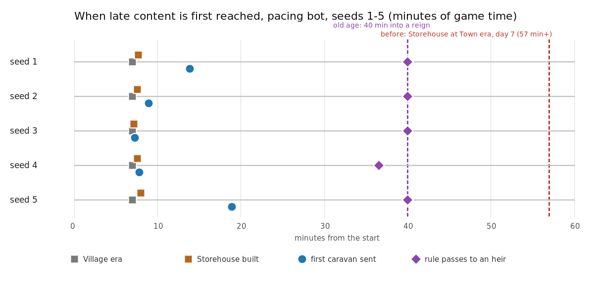

The chart is drawn from `pacing-report.json` by `python3 tools/pacing-milestones-chart.py pacing-out/pacing-report.json OUT.png src/BeyondNations.Desktop/assets/fonts/DejaVuSans.ttf` (ImageMagick). The screenshots below are the bot's own run on seed 3, saved with `--save-at` and loaded in the game with `--continue` (and `--start-screen laws`). They show:

- the bot on day 2 of the Village era, just after it sent a caravan of 6 wood and 5 stone;
- day 4, when the chronicle says the founder is growing old;
- the Laws tab naming the heir, with when old age comes and *Abdicate*, on desktop and phone;
- the succession screen when the founder dies of old age, 40 minutes in.

A run consumes the succession notice five seconds after it appears, as a player pressing *Continue* would, so a world saved later does not open on an old succession.

| | |
|---|---|
| 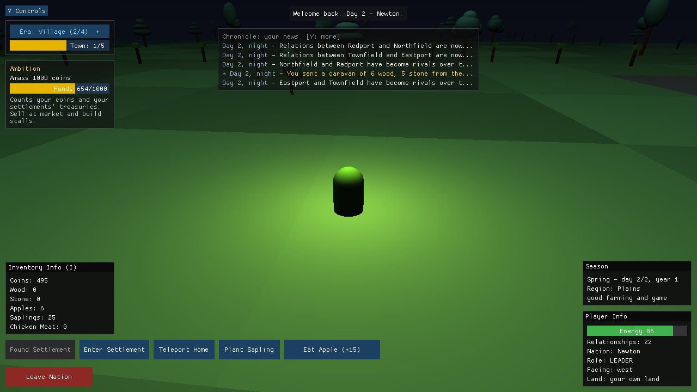 | 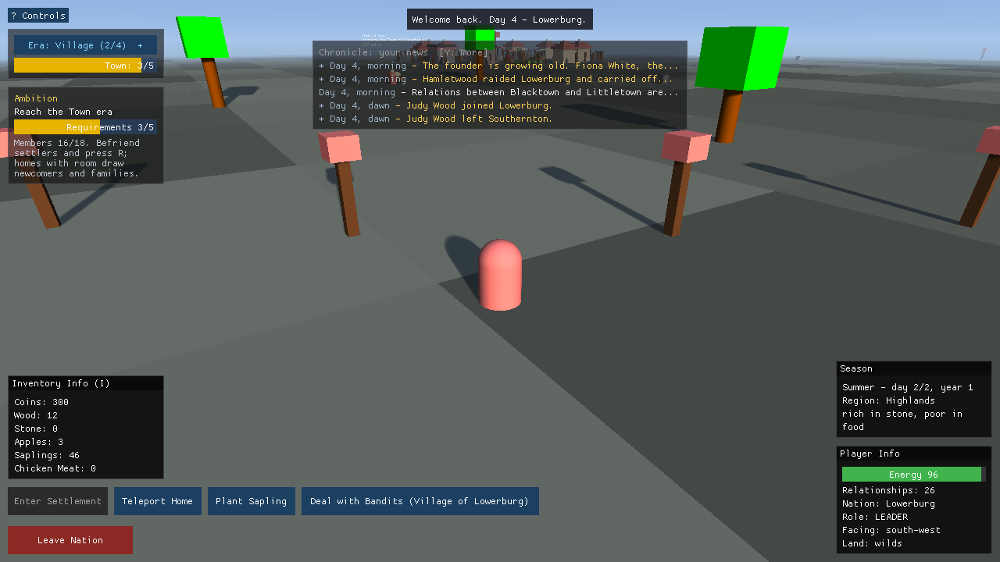 |
| 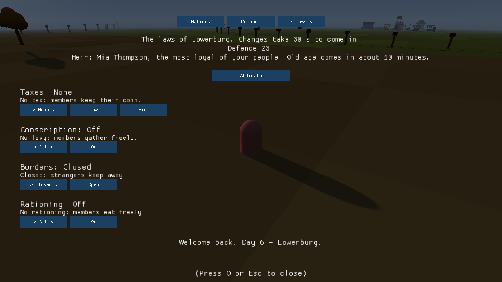 | 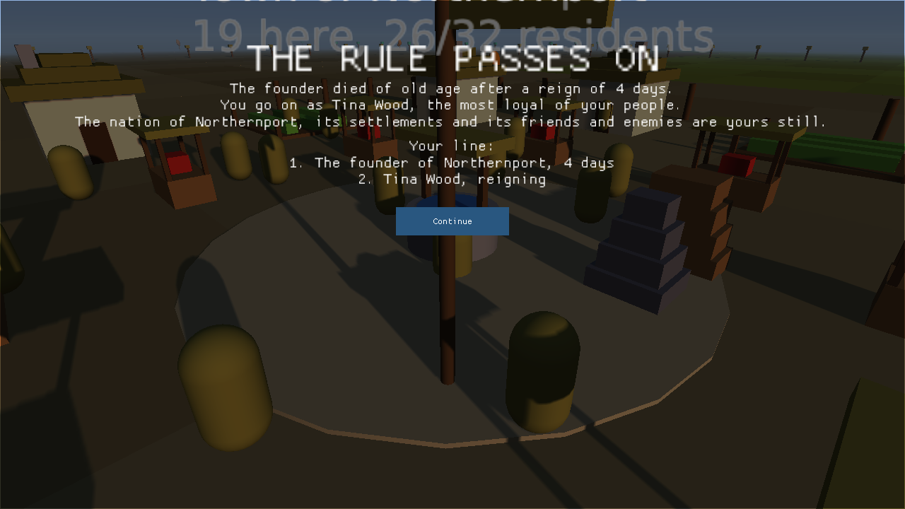 |

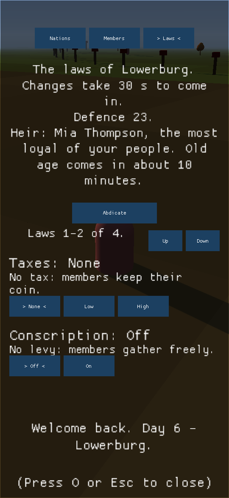

They were added for #372 and #373: in the 0.6.0 playtest neither a caravan (the storehouse waited for the Town era, day 7) nor a succession (rulers died only of hunger) could be met in a session. The storehouse now comes with the Village era and rulers grow old after forty minutes (SYSTEMS.md), and these keep them in reach.

## Unlocks

A new game shows only what its first steps need; every other part of the HUD, and each family of command-bar buttons, comes when play makes it useful, with one card saying why (`src/BeyondNations.Desktop/ui/progression/HudUnlocks.cs`, after Primordial Rise's and FishE's unlocks). The rules read the world through `UnlockSnapshot`, which only reads, and the harness compiles both in, so every run records when each unlock's own condition first holds (checked once a second and on every tick an objective completes; the report's **Unlocks** table and `unlocks` in the JSON). Watching them changes nothing: the report is identical, objective by objective, sample by sample, to a run without them.

An unlock whose part an objective's hint points at (`neededBy`) is also unlocked as soon as that objective is the current one, so no player is ever pointed at a hidden button. The check leaves that safety net out and **fails** when an unlock's own condition first holds after an objective that needs it became current, or never holds in the run, so a full session meets every unlock by itself.

The table, in the order the unlocks usually come for a person (the bot founds its nation in seconds, so it meets most of them in the first minute). Walking, Use, Eat, the energy, food and coin meters, the season chip, the inventory, the NEXT line, the Journal, the map and the menu are never locked. Measured on seeds 1 to 5, one hour each:

| Unlock | Comes when | Shows | Needed by | seed 1 | seed 2 | seed 3 | seed 4 | seed 5 |
|---|---|---|---|---|---|---|---|---|
| `Nation` | the first wood, stone or meal | Create, Join and Leave Nation; the nations screen | Create or join a nation | 1 s | 1 s | 1 s | 1 s | 1 s |
| `Founding` | the player leads a nation | Found Settlement | Found a settlement, Found a second settlement | 5 s | 5 s | 4 s | 4 s | 4 s |
| `Settlement` | a home, or a settlement within reach | Enter and Exit Settlement, Teleport Home, Settlement; the settlement box | Enter your settlement | 8 s | 12 s | 10 s | 7 s | 7 s |
| `Era` | the nation's first settlement | the era chip and card, the Journal's Era tab | Reach the Village era | 8 s | 12 s | 10 s | 7 s | 7 s |
| `Settlers` | a nation with a home | Talk to, Gift and Invite a pawn | Reach the Village era | 8 s | 12 s | 10 s | 7 s | 7 s |
| `Saplings` | a sapling, once there is a home | Plant Sapling | | 8 s | 12 s | 10 s | 7 s | 7 s |
| `Members` | a leader with a second member | Order and Appoint; the members panel | | 8 s | 26 s | 10 s | 7 s | 8 s |
| `Building` | inside a settlement the player may build in, or a stall or building of the nation's | Build Stall, Build House and the rest | Build a market stall | 9 s | 13 s | 11 s | 8 s | 8 s |
| `Crafting` | wood and stone for an axe or pickaxe, or one carried | Craft and Buy Axe or Pickaxe; the crafting screen | | 14 s | 22 s | 15 s | 13 s | 12 s |
| `Treasury` | coins or a stockpile in one of the nation's settlements | Withdraw Funds, Collect Stockpile | | 14 s | 30 s | 16 s | 11 s | 13 s |
| `Market` | a settlement with a stall | Purchase Food, Sell Resources, Trade at Market, the stall buttons; the market box | Sell resources at market | 16 s | 27 s | 17 s | 14 s | 13 s |
| `Laws` | a leader of five, or of a village | the Laws tab (and the heir) | | 31 s | 1m 02s | 30 s | 31 s | 15 s |
| `Diplomacy` | a leader on another nation's land, or with a rival | Gift, Propose Alliance, Offer Peace, Denounce, Declare War | | 1m 00s | 46 s | 1m 00s | 49 s | 58 s |
| `Caravans` | the Village era, or a caravan in reach | Send Caravan and the caravan's buttons | | 7m 00s | 7m 00s | 7m 00s | 7m 00s | 7m 00s |
| `Feeding` | hungry residents here, or autumn in a nation | Feed Residents | | 37m 00s | 22m 34s | 37m 00s | 37m 00s | 37m 00s |
| `Winter` | autumn | the winter countdown and food line | | 37m 00s | 37m 00s | 37m 00s | 37m 00s | 37m 00s |

On seed 1 each unlock that an objective needs comes before that objective is current, or on the same tick: Found Settlement at 5 s as "Found a settlement" comes up, the settlement buttons at 8 s with "Enter your settlement", Building at 9 s with "Build a market stall", the era and settlers at 8 s, long before "Reach the Village era" at 16 s, and the market at 16 s, long before "Sell resources" at 7m 00s. Every unlock comes on every seed. The objective times, milestones and curves are identical, to the sample, to a run without the unlocks watched.

## What is measured

For every objective on every seed:

- **time**: seconds of game time from the previous objective's completion (or the start of the world) to this one's. This is the number the budget checks.
- **completion time**: total ticks, game time and in-game day when it completed.

And, every 30 seconds of game time, the curves: nations alive, pawns alive, pawns in no nation (`nationless`, the strangers left to court), the player's nation's members and settlements, the player's coins, funds (coins plus the nation's treasuries), wood and stone, objectives completed, and what the bot was doing.

And, for every HUD unlock (above, "Unlocks"), the time its condition first held.

And, over the whole run, how many times the player's nation was raided (and how many an hour) and how many raids it made (a **Raids** table; `raidsOnPlayer`, `raidsOnPlayerPerHour`, `raidsByPlayer` in the JSON), and when the player's nation first had a member besides the player, an heir (`firstMemberSeconds`, and on the console line).

And, once a second, whether the player's nation has every requirement to leave its era **but the day**: the report's **Calendar waits** table gives, for each era, when that first happened and how long the nation then waited on the calendar alone (`calendarReadyTick`, `calendarWaitSeconds` in the JSON). That is time in which nothing the player does brings the next era sooner (below, "Calendar waits").

The report goes to `pacing-out/pacing-report.md` (readable, with one curve row per minute) and `pacing-out/pacing-report.json` (everything). In CI it is the job summary of **Build and test** and the `pacing-report` artifact.

## Running it locally

```bash
export PATH=/root/.dotnet:$PATH   # wherever your .NET 8 SDK is
dotnet run --project tools/BeyondNations.Pacing -c Release -- --check
```

That runs the seeds, objective limit and tick cap in the budget file, writes the report to `pacing-out/`, and exits 1 if any objective is out of budget. Options:

| Option | Meaning |
|---|---|
| `--budget FILE` | the budget to read (default `docs/pacing-budget.json`) |
| `--seeds 1,2,3` | other seeds |
| `--objectives N` | stop each run after N objectives |
| `--max-ticks N` | stop each run after N ticks |
| `--out DIR` | where the report goes (default `pacing-out`) |
| `--check` | exit 1 on a failure |
| `--write-budget` | rewrite the budget file from these runs |
| `--trace` | print every status line the bot's player sees, with its time, one seed at a time |
| `--save-at T1,T2` | save each seed's world at these ticks into `DIR/saves` as ordinary save files, to load in the game (copy one into the saves directory and start with `--continue`); the screenshots below were taken that way |

`--trace` is the way to find out why an objective is slow: it shows what the bot was doing and what the game told it.

## The budget

Each entry in `docs/pacing-budget.json` gives an objective's `id`, its `title` (for people reading it), `minSeconds` and `maxSeconds`, and optionally a `note` and `advisory`. The file also sets the `seeds`, `objectiveLimit` (how many objectives a run plays) and `maxTicks` (when a run gives up).

A run **fails** the check when an objective:

- finishes in **less** than `minSeconds`. A minimum states a design intent: it is the time below which the player did not really do anything for the objective. A teaching step that is one key press has a minimum of 0.
- finishes in **more** than `maxSeconds`;
- **never** finishes before the run ends.

It only **warns** when:

- the objective has no budget entry, which is what happens when someone adds or renames objectives;
- a budget entry is never reached (it was renamed or removed, or a run stopped before it);
- the entry is `advisory`: it is reported as too fast, too slow or never, but does not fail the build. Use this for objectives that are still being balanced.

### Updating the budget

When you change pacing on purpose (a cost, a target, a new objective):

1. Run `dotnet run --project tools/BeyondNations.Pacing -c Release -- --write-budget`. It sets each maximum to twice the slowest time plus a minute, and each minimum to half the fastest time, keeping a hand-set minimum that is lower. It keeps `advisory` and `note` and marks new ambitions as advisory.
2. Read the diff. The minimums in particular are design decisions, not measurements, so set them to what the objective should take, not what it happens to take now.
3. Run `--check`, and commit the budget with the change that needed it, saying why in the pull request.

A failing check is a real result. Before you widen a budget, read the report and a `--trace` and decide whether the game or the budget is wrong.

## Measured timings (seeds 1 to 5)

Seconds of game time per objective, at 50 ticks a second and 30 000 ticks (10 minutes) a day:

| Objective | seed 1 | seed 2 | seed 3 | seed 4 | seed 5 | budget |
|---|---|---|---|---|---|---|
| Gather wood | 3 | 3 | 2 | 2 | 2 | 0 – 120 |
| Eat something | 1 | 1 | 1 | 1 | 1 | 0 – 60 |
| Create or join a nation | 1 | 1 | 1 | 1 | 1 | 0 – 60 |
| Found a settlement | 3 | 7 | 6 | 3 | 3 | 0 – 180 |
| Enter your settlement | 1 | 1 | 1 | 1 | 1 | 0 – 60 |
| Build a market stall | 7 | 14 | 6 | 6 | 5 | 0 – 120 |
| Reach the Village era | 404 | 393 | 403 | 406 | 407 | 300 – 1800 |
| Sell resources at market | 11 | 11 | 6 | 5 | 4 | 0 – 180 |
| Found a second settlement | 16 | 1 | 1 | 13 | 28 | 0 – 120 |
| Grow your nation to 16 (ambition) | 363 | 109 | 1 | 170 | 659 | 5 – 2400, advisory |
| Amass 1000 coins (ambition) | 80 | 89 | 62 | 81 | 85 | 30 – 3900, advisory |
| Hold 3 settlements (ambition) | 25 | 1 | 38 | 1 | 23 | 0 – 300, advisory |
| Reach the Town era (ambition) | 2505 | 2789 | 2892 | 2730 | 2201 | 0 – 5400, advisory |
| Grow your nation to 25 (ambition) | 1 | 1 | 1 | 1 | 1 | 300 – 3600, advisory |

Measured with eras (Camp to Kingdom, see SYSTEMS.md) and the hungry start (the player begins at 85 energy), on develop with seasons, regions, rulers, world events, trade and spoiling apples, for one hour of game time a seed (`maxTicks` 180 000, 14 objectives). Spoiling apples (SYSTEMS.md, "Seasons") left every binding objective inside its budget and the budget unchanged; the arc to the Village era is unchanged to the second. Among the advisory ambitions, seed 3 now amasses its 1000 coins and goes on to the Town era (it stalled on the coins before), seed 1 now grows to 25, and the Town era takes longer on seed 1 (36 minutes after the previous step, against 24). The arc up to the Village era takes 17 to 20 minutes of game time on seeds 1 to 15. Starving pawns foraging rather than walking home to a market that cannot feed them (SYSTEMS.md, "Seasons") left the binding objectives and the arc to the Village era unchanged; it moved the advisory ambitions a little (seed 3 grows to 16 four minutes later and amasses its coins later, the Town era comes earlier on seeds 3 and 5), and the budget is unchanged. The table was last regenerated on develop with pawn energy capped at a full bar (#340) and Interact acting on what the player faces (below, "Known issues"); the budget is unchanged. It was regenerated again with the Village era at day 2 instead of day 3 (#352, below in "The eras") and the player's nation growing past a full world (#371, below in "Recruiting"): the Village era now comes at 7m 00s on all five seeds (17m 00s before), so the steps after it come ten minutes sooner and the members ambitions, no longer met while the bot waited for day 3, take two to three minutes. The Town era still comes at 57m 00s, its day. Every binding objective is inside its budget and the budget's numbers are unchanged; only the Village era's note was rewritten. "Grow your nation to 25" is met within a second on every seed (advisory, too fast): with #371 the courting bot's nation is well past 25 members by the time that ambition comes up. It was regenerated once more, from a fresh run, with the Storehouse in the Village era, the bot building one and sending caravans between other work, pawn-led settlements held to village tier before day 7 and rulers growing old (#372, #373; "Milestones", above), on develop with settlement holders (#459) and the bot answering world-event sheets (#460). Every binding objective is inside its budget and the budget is unchanged. Taking the winter apples away from the player (SYSTEMS.md, "Seasons") changed nothing here: the report is identical to develop's, objective by objective and milestone by milestone (the founder still dies of hunger at 36m 39s on seed 4 and of old age at 40m 00s on the others), because a day is 10 minutes and winter begins on day 6, at 57m 00s (the world starts 0.3 of the way into day 0; this said 60m 00s until #504), fifty ticks before the bot's run ends at 57m 01s. The bot never chops a tree in winter, so its budget cannot show the change; the deaths it makes are measured in SYSTEMS.md instead.

### The opening (#351, #370, #433)

Keeping the spawn's trees and a would-be founder's ground for the player in the opening (`ReservedGround`), and the first world event within a minute and a half of founding, left every binding objective where it was: on seeds 1 to 5 the steps up to "Build a market stall" take the same seconds as on develop, the Village era is still 7m 00s, and "Sell resources" and "Found a second settlement" moved by at most 30 seconds. The bot does not see the spawn changes, since it founds where it gathers its wood, a few seconds in; they are for a person who reads the tips first. Measured headless instead (`docs/screenshots/early-game-opening/`): on seed 1450162717 the nearest tree to the idle player is 33.5 m away at 1, 40 and 120 seconds, against 165 m at 40 seconds on develop; on seed 102, with a nation made at once and not yet settled, the nearest settlement to the player after two minutes is 356 m off, against 102 m; and a player who founds 20 seconds in meets their first event at 110 seconds, against 557.

The bot now answers each world event's sheet (above) instead of leaving it to its default, because the first event used to come after the arc and now comes in the middle of it: left alone, the bandits' default ("bar the gates") robbed the bot's village every minute for a day and a half. The advisory ambitions after the Village era all still complete: "Grow your nation to 16" takes 13m 30s, 8m 00s, 9m 32s, 10m 55s and 14m 01s from the start on seeds 1 to 5, against 22m 01s, 19m 00s, 8m 05s, 7m 03s and 9m 42s on develop, and the Town era and "Grow your nation to 25" are unchanged at 57m. The budget is unchanged.

Answering events also brought out a crash: a claimant the player warns against is put out of their nation (`Realm.expel`), and if they were indoors at the time the next behaviour decision dereferenced their missing nation. A nationless pawn inside a settlement now walks out (`PawnBehaviorCalculator`).


### Winter (#504)

Making winter harsher again (starving pawns sheltering at home ration at 0.4 of the indoor rate instead of a quarter; SYSTEMS.md, "Winter's toll") left the budget unchanged, and `--check` passes. That is by construction rather than luck: the change only acts in winter, and winter begins at 57m 00s (tick 171,000, the first tick of day 6 counted from the world's start at 0.3 of day 0), fifty ticks before the bot's run ends at 57m 01s once its 14 objectives are done. Every objective and milestone is reached before winter, so the report is the same as develop's up to then; the warnings it gives ("Grow your nation to 16" and "to 25" too fast, both advisory) come before winter too.

The bot is still the measure of winter: driven on through the first winter and half a day of spring (outside `--check`, seeds 1 to 8), the bot's own nation, which does nothing for winter, loses 5.5 members a winter against 3.1 (the whole world 7.9 against 4.1), and the same nation stocked to the winter store on the eve of winter loses 0.4 against 0.1. The per-seed table is in SYSTEMS.md.

### The eras

When each era was reached, in minutes of game time from the start of the world, over four hours a seed (`--objectives 30 --max-ticks 720000 --seeds 1,...,10`):

| Era | 1 | 2 | 3 | 4 | 5 | 6 | 7 | 8 | 9 | 10 | aimed at |
|---|---|---|---|---|---|---|---|---|---|---|---|
| Village | 7.0 | 7.0 | 7.0 | 7.0 | 7.0 | 7.0 | 7.0 | 7.0 | 7.0 | 7.0 | 7 – 15 |
| Town | 57.0 | 57.0 | 57.0 | 57.0 | 57.0 | 57.0 | 57.0 | 57.0 | 57.0 | 57.0 | about 60 |
| Kingdom | 177 | 177 | 177 | 177 | 177 | 177 | 177 | 177 | 177 | 177 | a few hours |
| Prosperity victory | 177 | 177 | 177 | 177 | 177 | 177 | 177 | 177 | 177 | 177 | |

Each era waits for its day as well as its requirements (`EraRules`: day 2, 7 and 19, 7, 57 and 177 minutes in, when this table was measured; the Town now waits for day 4, 27 minutes in, and the Kingdom for day 6, 47 minutes in, with more asked of it, below in "Calendar waits"), because settlers flock to a new nation that courts them, and without the calendar most seeds were a village within two or three minutes and a town within ten. The table was measured with the player's nation growing past a full world (#371) and the Village at day 2 (#352). The bot courts every settler, so for it the calendar is the floor on every seed and every era. Before those two changes (Village at day 3, about 17 minutes), the Village came at 17.0 to 19.9 minutes, the Town at 57 to 171, and the Kingdom on 3 of the 10 seeds; where the times ran past the day, the bot was short of members, which #371 fixed. Now the bot also wins: Prosperity (40 members and 6,000 funds in the Kingdom era, then) comes within a few seconds of the Kingdom on every seed, so the run is decided by the Kingdom's day (until the Kingdom's change in "Calendar waits"). Before #371 it never won. These four-hour runs were not repeated with #371 alone, so the victory cannot be credited to one change or the other, though the Village's day does not gate the Town or the Kingdom. For a player who does not court, the Village comes at 7 to 14 minutes ("Recruiting", below). The Village era is binding in the budget again (the calendar means it can no longer be met within a second); the Town and Kingdom eras are advisory.

### Calendar waits

The Town era waited for day 7, 57 minutes in. The courting bot had everything else the era asks (a town, 18 members, 2 settlements, 1,000 funds) 8 to 10 minutes in, and then waited on the calendar alone for 35 to 49 minutes: at the Village era's cap of three settlements, with every stranger in the world taken by minute 18 to 43 (the world at its 120 pawns), and its objective list stuck on "Reach the Town era: Requirements 4/5, Day 3/7". A bot that never courts had them by minute 10 to 18 on seeds 1, 3 and 5 and waited 38 to 47 minutes. So a session of 45 to 60 minutes never saw the Town era, its fourth to sixth settlements, or a siege, and the longest stretch of a normal game was a wait with nothing to decide. It was the same fault #352 fixed for the Village era, three times longer.

The Town era now waits for day 4, 27 minutes in (`EraRules.TownDay`). Seeds 1 to 5, one hour each (`Ready` is when every requirement but the day was met; `waited` is the time spent so):

| | seed 1 | seed 2 | seed 3 | seed 4 | seed 5 |
|---|---|---|---|---|---|
| courting bot, day 7: Village era waited | 47m 42s | 35m 34s | 47m 02s | 49m 10s | 48m 46s |
| courting bot, day 4: Village era waited | 17m 42s | 9m 23s | 17m 02s | 19m 10s | 18m 46s |
| courting bot, Town era reached (day 7 → day 4) | 57m 00s → 27m 00s | 57m 00s → 27m 46s | 57m 00s → 27m 00s | 57m 00s → 27m 00s | 57m 00s → 27m 00s |
| `--no-courting`, day 7: Village era waited | 47m 00s | never ready | 38m 29s | never ready | 46m 17s |
| `--no-courting`, day 4: Village era waited | 17m 00s | never ready | 8m 29s | never ready | 16m 17s |

(Seeds 2 and 4 without courting stay at 13 members, short of the Town's 18, either way: the Village-era member stall of #371.) Every binding objective is unchanged to the second and inside its budget; the Storehouse, caravan and succession milestones are unchanged; "Reach the Town era" now takes 18 to 19 minutes after the step before it, against 47 to 49. The new `town-era` milestone (by 40 minutes) keeps the Town era inside a session. The bot still waits 9 to 19 minutes, which is time to build the town and the third settlement for a person slower than it; at day 3 (17 minutes) the Village era would last ten.

Bringing the Town era into the session brought its raids too, and they were a storm. The shelter's ration (one raid on the player's nation every two minutes) ended with it, and every Hostile neighbour raided every fourth round: on seed 2 seven of them, every 20 seconds, 185 raids in the twelve minutes after the era came, and the status line a wall of `... raided your village: 5 coins, 5 wood, 5 stone taken` (without courting, 141 and 251 raids on seeds 1 and 3). With the era at 57 minutes the courting bot's nation had mostly outgrown its neighbours by then (only a stronger nation raids), and seed 2 took 31 raids in the two hours after it; a nation that comes to the Town era smaller, as now, or a person's, met the storm. Now, after its shelter, the player's nation is raided at most once a minute (`Diplomacy.PLAYER_RAID_EVERY_ROUNDS`), by whichever hostile neighbour comes first: 13 raids in those twelve minutes on seed 2, 13 on seeds 1 and 3 without courting. Other nations raid each other as before.

| | |
|---|---|
| 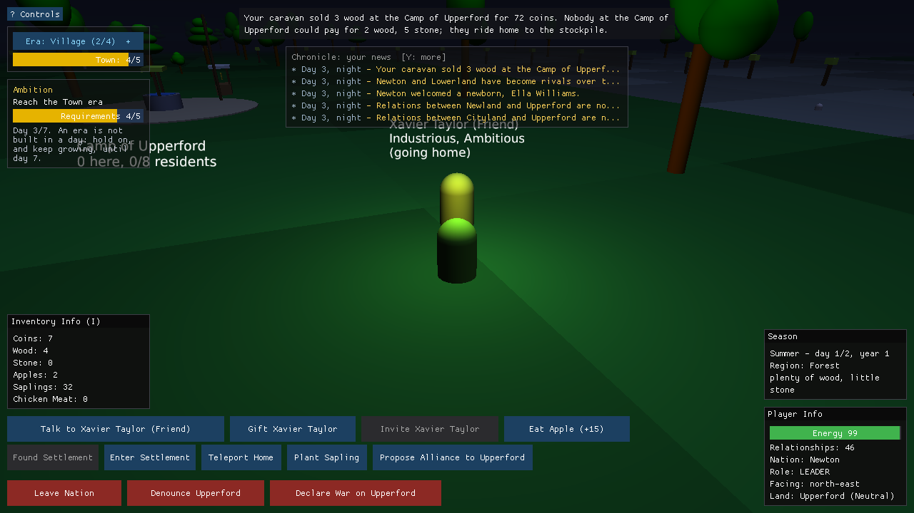 | 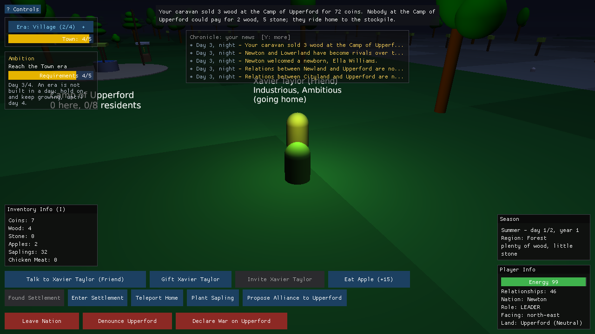 |
| 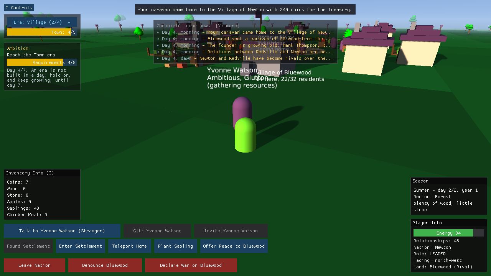 | 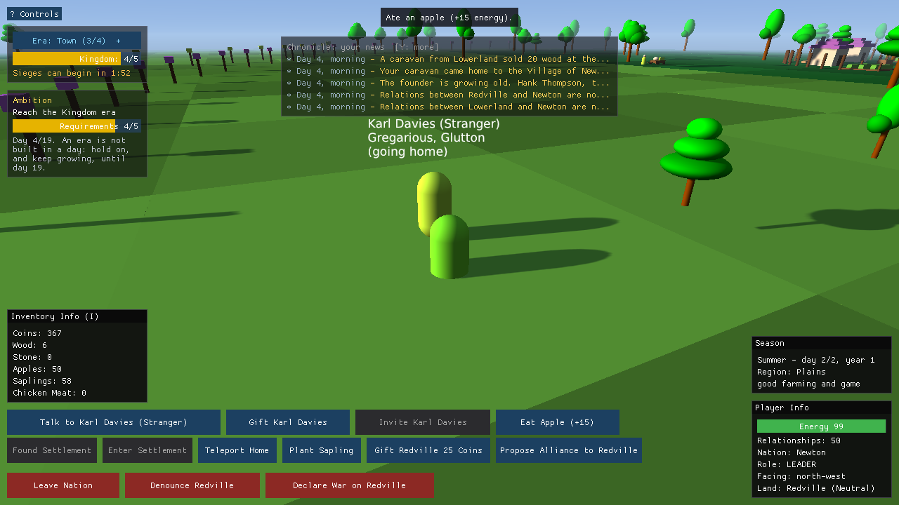 |

Over four hours (`--objectives 30 --max-ticks 720000`, seeds 1 to 5) the Kingdom era still came at 177m 00s and a Prosperity victory within a minute of it on every seed, so the end of a run was unchanged. The cost was the Town era's own calendar wait, which this change lengthened: the bot had the Kingdom's requirements 27 to 37 minutes in and waited 140 to 150 minutes for day 19, against 112 to 120 minutes (ready at 57 to 58) with the Town at day 7. Raids on the player's nation over those four hours fell from 57 to 26 on seed 2 (none on the others either way).

#### The Kingdom

So the Kingdom got the same treatment. It waits for day 6 (47 minutes in), not day 19, and asks for more, so that what the nation has, not the calendar, decides when it comes: 3 towns (was 2), 40 members (was 25), 5 settlements (was 4) and 6,000 funds (was 3,000) (`EraRules.Kingdom*`). The Prosperity victory, which asked for 6,000 funds and 40 members in the Kingdom era and so was already won by the time the Kingdom came, now asks for 15,000 funds and 50 members (`VictoryRules.Prosperity*`), so it is something to work towards in the Kingdom. Seeds 1 to 5, four hours each (`--objectives 30 --max-ticks 720000`), with the ambitions of the next section:

| | seed 1 | seed 2 | seed 3 | seed 4 | seed 5 |
|---|---|---|---|---|---|
| Town era: ready for the Kingdom but the day (before) | 33m 40s | 36m 54s | 27m 29s | 27m 55s | 28m 05s |
| Town era: waited on the calendar (before) | 142m 27s | 140m 06s | 149m 31s | 143m 42s | 148m 55s |
| Town era: ready for the Kingdom but the day (after) | after day 6 | 41m 55s | after day 6 | 37m 40s | 36m 28s |
| Town era: waited on the calendar (after) | none | 3m 49s | none | 4m 40s | 8m 52s |
| Kingdom era (before → after) | 177m 00s → 103m 50s | 177m 00s → 47m 00s | 177m 00s → 52m 00s | 177m 00s → 47m 20s | 177m 00s → 47m 00s |
| Prosperity victory (before → after) | 177m 04s → 177m 36s | 177m 04s → 86m 55s | 177m 04s → 164m 40s | 177m 04s → 135m 20s | 177m 04s → 73m 06s |

("none": the nation had the rest only after day 6, so the requirements alone decided.) The Kingdom now comes 47 to 52 minutes in on four seeds, inside a long session, and the victory 26 to 113 minutes after it, when the nation has built up to it: on every seed the bot's funds were just under 15,000 a minute before it won. Seed 1 is slow for a reason of the bot's: it sat on the ambition "Amass 3500 coins" for an hour with three settlements, as it plays only its current objective and earns coins slowly at that size, and with the Town era's settlements ambition after it. A person founds a fourth settlement when they like.

The screenshots are seed 3's bot world, saved with `--save-at 54000,90000` and loaded with `--continue`, before and after the change.

### Ambitions

The ambitions after the first arc took their targets from the era they were made in alone (`ObjectiveCatalog.eraMembers`, `eraFunds`), and the nation had often long passed them: over seeds 1 to 5 "Grow your nation to 16" and "Grow your nation to 25" were met within a second of appearing on every seed, "Hold 3 settlements" on four, and "Amass 1000 coins" on three of them without courting. Each was a toast and a reward for nothing.

Now an ambition's target is set from the nation as it stands when the ambition appears (`ScaledAmbition`), and never below the era's floor:

- **Members**: 5 more than it has. Once no stranger is left in the world to invite, members come only from births and newcomers, which need room, or from winning over another nation's people, so the ambition asks for 3 more buildings instead ("Put up 35 buildings"), and its hint says why (below). Asking for members then left the bot on "Grow your nation to 87" for three and a half hours, at 70 to 76 members in a full world.
- **Funds**: a fifth more, and at least 500 more, rounded up to a hundred ("Amass 1200 coins").
- **Settlements**: one more than the nation holds; at the era's limit, 3 more buildings than it has, as before.

The Town era's funds floor is half the Kingdom's 6,000 (3,000), so that ambition stays a step on the way and the settlements ambition after it comes in time. Nothing new is saved: the target is in the current objective's saved progress counter, and a load gives it back (`ObjectiveTracker.load`).

The bot's first seven ambitions, seeds 1 to 5, before → after (seconds each took):

| | seed 1 | seed 2 | seed 3 | seed 4 | seed 5 |
|---|---|---|---|---|---|
| ambition-0 | Grow your nation to 16: 1 → to 34: 36 | to 16: 1 → to 23: 127 | to 16: 1 → to 39: 114 | to 16: 1 → to 40: 38 | to 16: 1 → to 37: 35 |
| ambition-1 | Amass 1000 coins: 47 → 1200: 45 | 1000: 115 → 1100: 68 | 1000: 61 → 1400: 51 | 1000: 34 → 1300: 41 | 1000: 53 → 1200: 37 |
| ambition-2 | Hold 3 settlements: 1 → Put up 29 buildings: 20 | Hold 3: 27 → Hold 3: 30 | Hold 3: 1 → Put up 30 buildings: 6 | Hold 3: 1 → Put up 29 buildings: 18 | Hold 3: 1 → Put up 23 buildings: 18 |
| ambition-4 | Grow your nation to 25: 1 → Put up 35 buildings: 20 | to 25: 1 → Put up 18 buildings: 34 | to 25: 1 → Put up 34 buildings: 9 | to 25: 1 → Put up 33 buildings: 10 | to 25: 1 → Put up 32 buildings: 6 |
| ambition-6 | Hold 4 settlements: 1 → 38 | 1 → Hold 5 settlements: 37 | 27 → 29 | 1 → 34 | 1 → 30 |

No ambition in the first four hours completed within a second of appearing, and "Win the game" no longer comes round after a victory: a lap made once the nation has won asks for more buildings instead (`VictoryAmbition`). The budget's ambition entries (`docs/pacing-budget.json`) are advisory and were set from these runs; their titles now vary by seed, so the budget names the first seed's.

When no stranger is left, the era's Members hint and the members ambition no longer say "Befriend settlers and press Invite": they say *No strangers are left: every settler belongs to a nation. Put up houses so your settlements have room, and keep food in store, for births and newcomers; or win over another nation's people with talk and gifts until they are Loyal, then invite them.* Once the world is also full (100 pawns plus the player's nation's 20), they say no child is born and no newcomer comes until it has room. `EraTracker` counts the strangers once a second. Neither names a key, since a phone player reads them too.

| | |
|---|---|
| 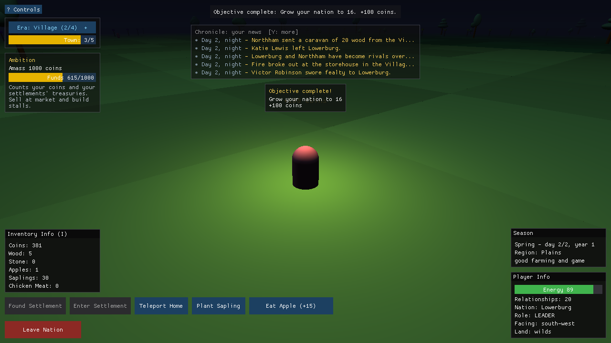 | 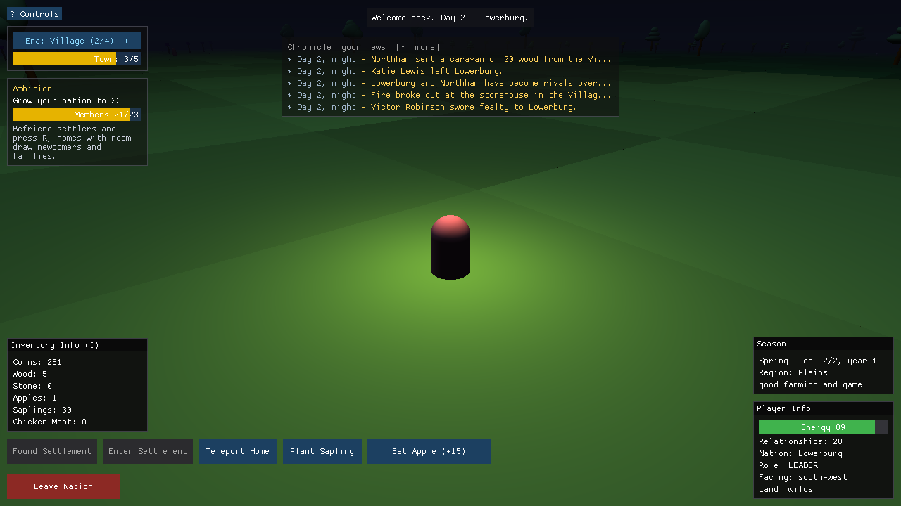 |
| 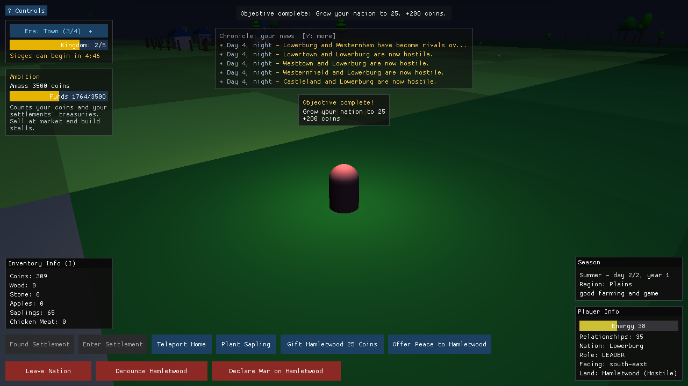 | 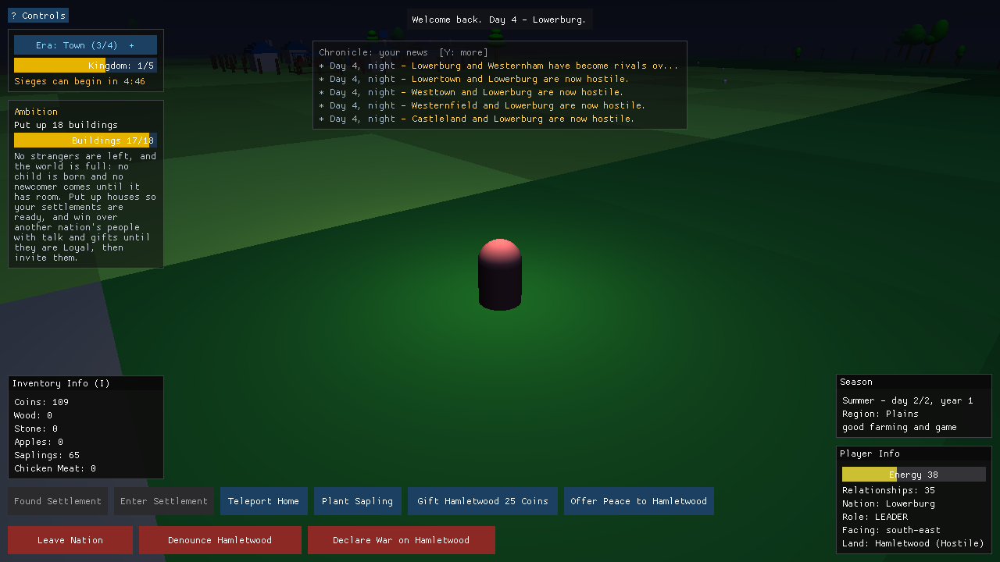 |

At phone size (390x844): 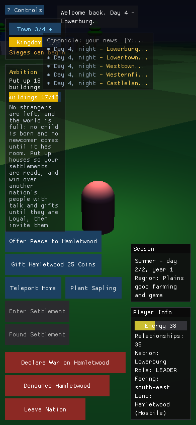 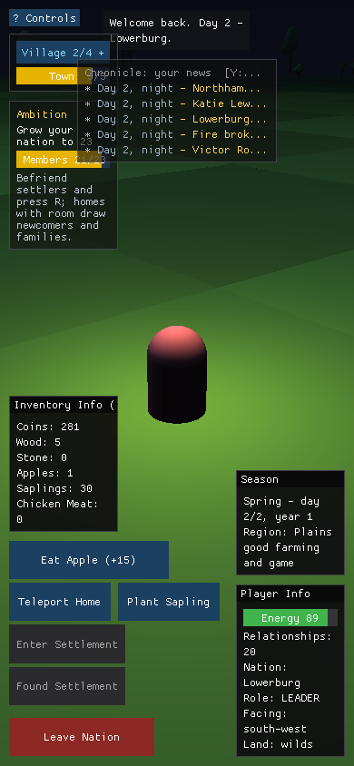

The worlds are seed 2's bot saved with `--save-at 25500,81600` and loaded with `--continue`, by the game before and after the change; the "before" game rebuilt the saved ambition with its old target. (The desktop build names the Invite key in the first after picture; on a touch screen the token reads as the button.)

### Recruiting

The bot courts settlers faster than a person can: it walks straight to the nearest one, never loses it, and gifts once a second. Playtesters at 3 to 17 frames a second could not keep a pawn in reach, and by the time their settlement stood, the AI nations had signed up every nationless settler. `--no-courting` measures the other way to grow: the bot builds its settlement and stalls as usual but never talks to, gifts or invites a pawn, so every member comes from the world (settlers who wander in, newcomers, births). The console line and the JSON (`villageMembersTick`, `membersInvited`, `membersJoinedOtherwise`) say when the nation first had the Village era's 10 members.

`--no-courting --seeds 1,...,10 --objectives 7 --max-ticks 90000` (30 minutes of game time a seed):

| Seed | 1 | 2 | 3 | 4 | 5 | 6 | 7 | 8 | 9 | 10 |
|---|---|---|---|---|---|---|---|---|---|---|
| 10 members, before #371's fix | never (4) | never (5) | never (6) | 8m 00s | never (6) | never (6) | 3m 31s | never (3) | never (6) | never (6) |
| 10 members, after | 10m 01s | 13m 01s | 9m 30s | 8m 00s | 7m 00s | 6m 30s | 3m 31s | 13m 00s | 10m 01s | 7m 30s |

(The number in brackets is the nation's members after 30 minutes.) Before, the world reached its 100-pawn limit within three to six minutes, and a full world drew no newcomer and bore no child, so the nation stopped growing for good; the Village era came on 2 of the 10 seeds. After, the player's nation may grow 20 pawns past the limit (SYSTEMS.md, "Population growth"), it gains a member every minute or two, and the Village era comes at day 3 (17m 00s) on all 10 seeds. The world peaked at 111 pawns. Courting still pays: the bot that courts has 10 members within about two minutes.

With the Village era at day 2 (#352, "The eras"), the same no-courting run reaches the Village era at:

| Seed | 1 | 2 | 3 | 4 | 5 | 6 | 7 | 8 | 9 | 10 |
|---|---|---|---|---|---|---|---|---|---|---|
| 10 members | 9m 31s | 13m 31s | 9m 31s | 8m 00s | 8m 30s | 6m 30s | 3m 31s | 13m 30s | 9m 31s | 9m 30s |
| Village era | 9m 43s | 13m 46s | 9m 45s | 8m 19s | 8m 39s | 7m 00s | 7m 00s | 13m 46s | 9m 38s | 9m 36s |


So on 8 of the 10 seeds the members, not the calendar, decide when the era comes (at day 3 it was 17m 00s on all ten, whatever the player did), and courting, which the bot here never does, would bring it sooner. Seeds 1, 2, 5 and 8 reach 10 members up to 31 seconds later than in the table above, which was measured on an older develop with the era at day 3.

Measured again for #371 on develop `2167959c` (0.8.1-SNAPSHOT: the early-nation limit, the hungry-nation rule of #489, settlement holders), with the same command:

| Seed | 1 | 2 | 3 | 4 | 5 | 6 | 7 | 8 | 9 | 10 |
|---|---|---|---|---|---|---|---|---|---|---|
| 10 members | 1m 04s | 11m 00s | 8m 30s | 8m 00s | 8m 01s | 2m 20s | 2m 16s | 6m 46s | 9m 30s | 5m 35s |
| Village era | 7m 00s | 11m 11s | 8m 48s | 8m 23s | 8m 12s | 7m 00s | 7m 00s | 7m 00s | 9m 58s | 7m 00s |
| Members at 30 minutes | 29 | 13 | 27 | 13 | 32 | 29 | 27 | 31 | 14 | 43 |

A player who never talks to, gifts or invites a single pawn now reaches the Village era by 11m 11s on every seed, and on five of the ten seeds the calendar (day 2, 7m 00s), not the members, sets the time. The stall #371 reported (4 of 10 members for thousands of ticks, no newcomer, no birth, then poaching at about 150 coins of gifts a pawn) does not come back: the nation gains its members from strangers who walk in (they now last into day 2, "Strangers on the first day" below) and from births and newcomers past a full world. So no rate was changed for it: newcomers, births and the price of a gift are as they were, and the budget is unchanged. Poaching still costs about 150 coins (Loyal is 30, a 10-coin gift adds 2), but a player no longer needs it to reach the Village; it is a way to grow faster, not the only way.

### Strangers on the first day

In the 0.8.0 playtest (s02, s06) nearly every wandering pawn had founded a nation of one by the afternoon of day 1 (17 nations by the 74th second in s06), so a new ruler had no stranger to court for a first member, an heir, or the Village era's ten. The rule was that a nationless pawn with 50 wood founds a nation of its own unless it stands within 100 units of a settlement. Now, before the Village era's day (day 2), it does so only while the world has fewer than six nations (`PawnBehaviorCalculator.EARLY_NATION_LIMIT`); from day 2, any pawn may again. `TestPacing.testStrangersStayRecruitable_ThroughTheFirstDay` runs seed 1 without courting to day 1's sunset and fails on the old rule (10 nations at 30 s).

Pawns in no nation / nations alive, at day 1 noon (2 minutes in), sunset (4m 30s), the start of day 2 (7 minutes), 10 and 15 minutes, seeds 1 to 5. "Before" is this harness with the old founding rule:

| | seed 1 | seed 2 | seed 3 | seed 4 | seed 5 |
|---|---|---|---|---|---|
| courting bot, before | 5/17, 2/24, 0/16, 0/12, 0/13 | 26/7, 1/30, 1/26, 1/17, 1/17 | 7/22, 2/34, 1/29, 1/21, 0/18 | 7/26, 3/29, 0/22, 0/22, 1/21 | 7/10, 2/39, 0/32, 1/25, 1/21 |
| courting bot, now | 41/7, 27/6, 18/7, 8/9, 0/8 | 27/6, 15/7, 10/8, 1/9, 0/11 | 17/7, 30/7, 24/8, 3/6, 0/9 | 23/7, 20/7, 15/6, 1/9, 2/11 | 8/7, 42/7, 22/8, 5/8, 0/9 |
| `--no-courting`, before | 3/21, 0/33, 1/26, 2/16, 0/14 | 7/6, 3/11, 2/12, 7/11, 0/18 | 11/19, 0/29, 4/22, 1/15, 1/15 | 15/28, 0/41, 0/28, 2/20, 0/21 | 13/20, 0/31, 0/21, 10/15, 0/16 |
| `--no-courting`, now | 9/6, 16/7, 13/6, 2/6, 0/6 | 7/6, 6/6, 1/6, 1/6, 4/6 | 15/6, 7/6, 6/6, 5/7, 2/8 | 4/6, 9/6, 3/7, 9/6, 1/7 | 0/6, 14/6, 6/6, 3/6, 0/7 |

Before, the world had 24 to 41 nations at sunset and 0 to 3 strangers; now it has 6 or 7 and 6 to 42 strangers, and they last into day 2. The courting bot empties the pool itself after day 2 (it invites 42 to 48 pawns an hour); a player who never courts still finds a few strangers at 15 minutes, and the world stays at 6 to 8 nations, because strangers who do not found nations walk into a settlement and join it. The courting bot has its first member 7 to 26 seconds in either way (it is faster than a person).

Every binding objective and milestone is inside its budget, and the budget is unchanged. With the courting bot (`--check`): the Storehouse at 7m 10s to 7m 41s (before 7m 08s to 7m 50s), the first caravan at 7m 21s to 9m 09s (before 7m 22s to 9m 10s), succession of old age at 40m 00s on every seed (before, seed 5's founder died and the rule passed at 22m 02s). Without courting the Storehouse now comes at 7m 32s to 14m 45s, against 8m 55s to 15m 02s before. With fewer, smaller neighbours the bot's nation is raided less: 0 times in the hour on seeds 1, 3, 4 and 5 (26 on seed 2), against 25, 26, 1, 1 and 1 before.

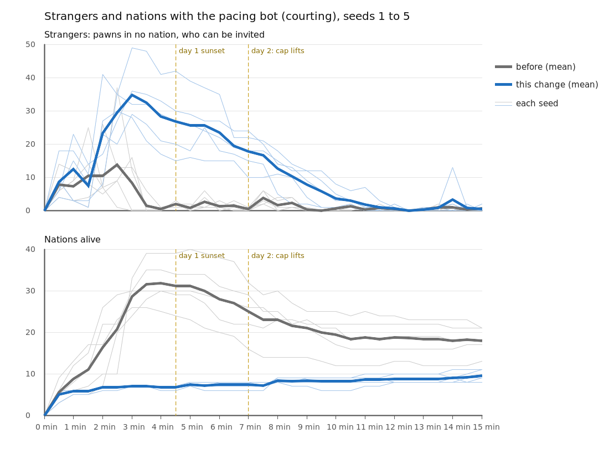

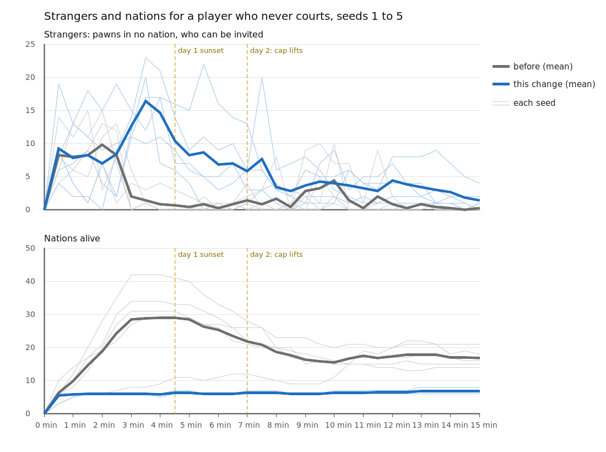

The charts are drawn from two `pacing-report.json` files by `python3 tools/pacing-strangers-chart.py BEFORE.json AFTER.json OUT.png src/BeyondNations.Desktop/assets/fonts/DejaVuSans.ttf [TITLE] [MINUTES]` (ImageMagick).

### Buying buildings

The fun pass found that a player who does not court piles up coins with nothing to spend them on: the only sinks were a stall, a gift and some event choices. Coins now buy buildings (SYSTEMS.md, "Building"), and the `--no-courting` bot grows its settlement with materials or coins (above, "The bot"). `--no-courting --seeds 1,...,5 --objectives 30 --max-ticks 180000`, the player's purse:

| | seed 1 | seed 2 | seed 3 | seed 4 | seed 5 |
|---|---|---|---|---|---|
| 30 minutes, before | 6,224 | 5,296 | 6,987 | 4,529 | 7,592 |
| 30 minutes, after | 1,592 | 1,838 | 1,926 | 1,635 | 1,911 |
| 56 minutes, before | 6,702 | 6,062 | 7,845 | 5,755 | 5,470 |
| 56 minutes, after | 3,194 | 3,712 | 3,520 | 2,952 | 3,185 |
| buildings bought (coins spent) | 7 (4,134) | 4 (4,110) | 9 (4,137) | 6 (4,581) | 8 (5,304) |
| Town era, before → after | 27m 00s → 27m 00s | never → 27m 00s | 27m 00s → 27m 00s | never → 27m 00s | 27m 00s → 27m 00s |

The bot used to only earn while it waited for members, sitting on thousands of coins and a pack of stone with its settlement three buildings big. Now, from the Village era on, it builds as it waits (not in the Camp era: houses then took in the strangers the first day keeps for courting, `testStrangersStayRecruitable_ThroughTheFirstDay`), and the houses make room for the settlers the world brings: seeds 2 and 4, which stalled at 13 members short of the Town era's 18 (above, "Calendar waits"), reach it at 27 minutes like the others. The Village era comes at the same second as before on every seed. The purse still grows after the Town era, since the bot keeps the Kingdom's 3,000 funds in hand. The courting bot does not buy, so the budget run and its numbers are unchanged.

### Upgrading buildings

Buying buildings stops being a sink once a settlement's twelve slots are full, and in the Town era the purse grew again. Coins now upgrade buildings (SYSTEMS.md, "Upgrading with coins"), and the `--no-courting` bot buys upgrades out of what the nation's funds hold above its next goal (above, "The bot"). Four hours a seed, `--no-courting --seeds 1,...,5 --objectives 30 --max-ticks 720000 --check`, before upgrades and after:

| | seed 1 | seed 2 | seed 3 | seed 4 | seed 5 |
|---|---|---|---|---|---|
| upgrades bought (coins spent) | 0 | 3 (3,600) | 3 (3,600) | 0 | 1 (1,200) |
| Kingdom era, before → after | 109m 42s → 109m 42s | 155m 31s → 155m 31s | 78m 42s → 75m 08s | 158m 31s → 158m 31s | 153m 06s → 159m 34s |
| Prosperity victory, before → after | never → never | 225m 31s → never | 159m 30s → 162m 00s | 214m 35s → 214m 35s | never → never |
| nation's funds at 4 hours, before → after | 7,759 → 7,759 | 14,584 → 13,370 | 25,347 → 27,002 | 24,534 → 24,534 | 12,253 → 8,275 |

("never": not within the four hours.) Seeds 1 and 4 bought nothing and ran to the same second. On the other three the bot did buy, and the trade-off is plain: an upgrade spends coins that the funds-bound Prosperity victory (15,000 funds and 50 members in the Kingdom era) needs later. The bot keeps only its *next* goal in hand, so in the Town era it spends what lies above the Kingdom's 6,000, and that money is missing when it then saves for 15,000. Seed 2 won at 225m 31s before; after 3,600 coins of upgrades its funds stood at 13,370 at four hours and it did not win. Seed 3 won 2m 30s later (162m 00s against 159m 30s), though its Kingdom came 3m 34s sooner. Seed 5 bought a single 1,200-coin upgrade and reached the Kingdom 6m 28s later; past that purchase the run went its own way, so not all of its difference is the upgrade's price. Every objective stayed within its budget on every seed (`--check`: "every objective is within its budget on every seed"). The courting bot does not upgrade, so the budget run is unchanged.

So upgrades are a sink with a cost: a player who upgrades has a bigger town and wins later, or not within four hours.

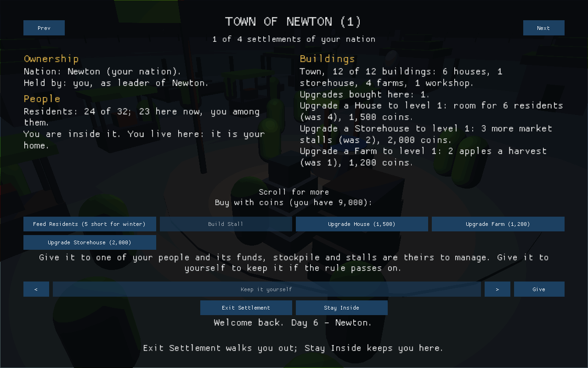

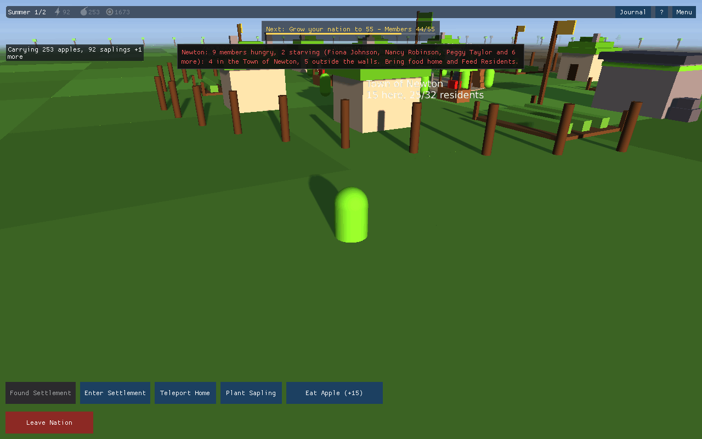

The screenshots are seed 3's run above, saved with `--save-at` at 56 and 100 minutes and loaded with `--continue` (SYSTEMS.md, "Upgrading with coins", has the rest).

## Known issues the harness found

- **"Grow your nation to 5" used to be met within a second on some seeds.** *It is now "Reach the Village era" (a village, 10 members, 2 stalls and day 2), binding at 300 – 1800 s.* Before seasons and regions (#318), settlers joined a new settlement on their own, and on seed 3 the nation already had five members when the step came up (1 s). The 5 s minimum fails that. On develop with #318 the step takes 18 s to 2 m 24 s, because nations now take up almost every settler in the first two minutes. So the target is unchanged, and the minimum stays to catch a return of the problem.
- **On most seeds a new player's nation was besieged and taken within about ten minutes.** *Addressed by eras: a nation the player leads cannot be besieged until the Town era (`EraRules.isSheltered`; raids still come), and a nation that falls apart for good ends the run as a defeat.* The original finding: By minute two the world has 25 to 45 nations and its full 100 pawns, so few nationless settlers are left to recruit, and Hostile neighbours at least twice the player's strength lay siege. Gifts only buy time. On seed 3 the bot's nation falls at about minute 5. Every nation it founds after that falls within a few minutes, so "Grow your nation to 10" never completes there. Before #318 this happened on four of the five seeds. This is why the ambitions are advisory for now. Make them binding once a new player can hold on.
- **"Amass 500 coins" was usually met when it came up.** The rewards from the arc, the starting purse and the treasuries already add up to more than 500. *Addressed by eras: the funds ambitions start from the era's floor, 1,000 in the Village era.*
- **"Eat something" was a one-minute wait for hunger.** *Addressed: a new world starts the player at 85 energy (`Player.NewWorldEnergy`), below the line under which carried food is eaten (90), so the first food picked up is eaten at once and the step takes about a second. Eating is still refused above 90, and the rate hunger drains is unchanged.* The original finding: the player started full and only eats below 90, so the step was about 58 s of waiting, and a player who kept chopping trees in that minute ended it with about 400 wood, so both "Found a settlement" steps took only seconds afterwards. They still take seconds: the bot gathers that wood while the settlement objective is current.
- **"Found a second settlement" took 134 s on seed 5 (budget 120 s) once pawn energy was capped at a full bar (#340).** *Addressed in the game: Interact acts on what the player faces.* The trace showed the bot standing 2.5 units from the tree it had walked up to and faced, while pawns strolled within 1 to 3 units of it; Interact gave a pawn in reach priority over a tree whatever the player faced, so for about 90 seconds every press talked ("Yes, leader? I hardly know you...", 338 status lines) instead of felling the tree. A person at that tree would have met the same wall (PLAYTESTING.md listed "a pawn standing by the tree wins" as a known trap). Now, past the drops and the well, E acts on whichever pawn, tree, rock or chicken in reach is most squarely in front (within 60 degrees), and keeps the old order only when nothing is. Seed 5 now takes 17 s; seeds 1 to 4 are unchanged to the second, and on seed 5 only the advisory ambitions after it moved (Hold 3 settlements 9 s to 10 s, the Town era 37m 28s to 39m 24s). The budget is unchanged.
