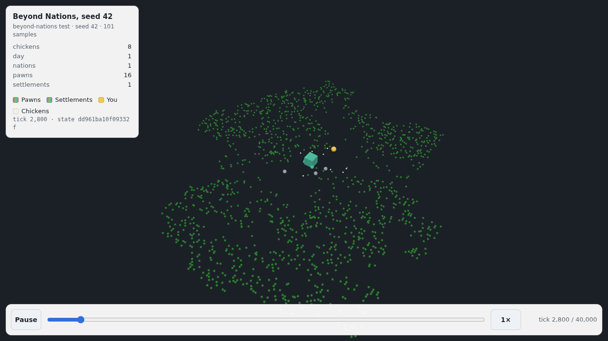

# Sharing a world

A world in Beyond Nations comes from a **seed**. The same seed builds the same world on every machine and in every build, desktop or browser. Sharing a world is a matter of sharing its seed. A run can also be exported, either as a replay you can watch in a browser or as a written history of your nation.

| | Where | What it does |
| --- | --- | --- |
| Seed field | New World screen (Start on the main menu) | Takes a number or any word. Empty builds a fresh world. |
| Random seed | New World screen | Fills the field with a fresh seed, so you can read it out or share it before you press Begin. |
| World seed | Pause screen, above the buttons | Shows the seed of the world in play. |
| Copy link / Share link | Pause → Share | Shares `https://beyond-nations.play.danielstephenson.dev/?seed=…`. |
| Export replay (USD) | Pause → Share | Saves this run as a `usd-replay/1` replay (`.usda`). |
| Export history (text) | Pause → Share | Saves the chronicle as "The History of <your nation>" (`.md`). |

## Seeds

The seed field and `--seed` read what you type with one rule (`src/BeyondNations.Core/sharing/WorldSeed.cs`):

- **A whole number is that seed.** `42` is seed 42, the same world `--seed 42` and `?seed=42` have always built.
- **Anything else is hashed to a seed.** The text is trimmed, then hashed with FNV-1a (32-bit) over its UTF-8 bytes into a positive number. `Ironvale` is always seed 1450162717. Case counts, so `ironvale` is a different world. `TestWorldSeed` pins this rule, because a change would send every shared word-seed to a different world.
- **Empty, or `0`, means a fresh world.** The game picks the seed and shows it on the pause screen afterwards.

Seeds work the same way everywhere:

```bash
dotnet run --project src/BeyondNations.Desktop -- --seed Ironvale            # the New World screen, filled in
dotnet run --project src/BeyondNations.Desktop -- --seed 42 --start-screen world   # straight into the world
```

In the browser, `?seed=` takes a number or text too. The New World screen opens with that seed already filled in, so a link starts the world it names. Add `&start-screen=world` to skip the menus.

```
https://beyond-nations.play.danielstephenson.dev/?seed=42
https://beyond-nations.play.danielstephenson.dev/?seed=Ironvale&start-screen=world
```

**On a phone,** a canvas cannot open the on-screen keyboard. In the browser, the seed field is therefore a button: tapping it opens the browser's own text prompt. The Random seed button and links need no typing.

## The share link

**Share** on the pause screen shows the seed and its link. The link always carries the number, even for a world named with a word, because the number is what the world is built from. **Copy link** puts it on the clipboard. On a phone or tablet whose browser has a system share sheet (`navigator.share`), the button is **Share link** and opens that sheet. If neither works, the screen shows the link so you can copy it by hand.

A seed rebuilds the *world* (the land, its first pawns and everything that happens without you). It does not rebuild your choices, so a friend who follows the link starts where you started, not where you are.

## Export replay (USD)

While a world is in play, the game records it (`RunRecorder`). Every 250 ticks (five seconds at 50 ticks a second) it notes:

- where every visible pawn, settlement and chicken is, and where you are
- each pawn's and settlement's nation colour
- the day, and how many pawns, settlements, nations and chickens there are.

Recording only reads the world and draws no random numbers, so it never changes what happens (`TestRunRecorder`). On a long run it keeps at most 1,000 samples. When it would exceed that, it drops every other sample and doubles the interval, so the replay still covers the whole run, just more coarsely.

**Export replay (USD)** writes those samples as a [`usd-replay/1`](https://github.com/Preponderous-Software/usd-recorder/blob/main/docs/REPLAY.md) replay: a single plain-text OpenUSD layer, `beyond-nations-seed-<seed>-tick-<tick>.usda` (`ReplayUsdaWriter`). It holds:

- `/Replay` with a state hash and the counters at every sample
- one point set each for pawns and settlements (in their nation's colours), you (gold) and chickens
- the trees standing at the moment of export, as a static backdrop.

The replay is Z-up, with one time code per tick. A final sample is taken at the moment of export, so the replay always ends where you are.

- **Desktop:** the file goes to `Exports` beside your saves, and the Share screen shows the full path. That is `~/.local/share/BeyondNations/Exports` on Linux (or `$XDG_DATA_HOME/BeyondNations/Exports`) and `%AppData%\BeyondNations\Exports` on Windows.
- **Browser:** the file downloads.

**The recording is not part of the save.** A loaded world starts a fresh recording at the tick it was saved at. The chronicle is saved, so the history export below still tells what came before.

### Viewing a replay

Check that the file is a valid replay with [usd-recorder](https://github.com/Preponderous-Software/usd-recorder), then turn it into a web replay with [usd-web](https://github.com/Preponderous-Software/usd-web) and open it in a browser:

```bash
pip install "usd-recorder @ git+https://github.com/Preponderous-Software/usd-recorder@v0.2.0" \
            "usd-web @ git+https://github.com/Preponderous-Software/usd-web@v0.2.0"

usd-recorder replay validate beyond-nations-seed-42-tick-40000.usda   # "conforms to usd-replay/1"
usd-recorder replay info     beyond-nations-seed-42-tick-40000.usda   # seed, ticks, samples, sets

usd-web replay beyond-nations-seed-42-tick-40000.usda -o site/replay --max-samples 300
cp <usd-web checkout>/viewer/replay.html <usd-web checkout>/viewer/usd-web-replay.js site/
python -m http.server -d site 8000      # open http://localhost:8000/replay.html?data=replay/
```



*Seed 42 over 40,000 ticks as exported by the game (`--game-replay`, below), in usd-web's player: the first nation's settlement (cube) and its pawns in the nation's colour, nationless pawns in grey, you in gold, and the trees as a backdrop. The panel shows the counters and the state hash of each sample.*

Any OpenUSD tool can open the `.usda` file too. In `usdview`, the time slider plays the run.

The same export can be made headless, without playing, for a seeded world left to itself. CI uses this to hold the in-game export to usd-recorder's validator ([CI-CD.md](./CI-CD.md)):

```bash
dotnet run --project tools/BeyondNations.HistoryExport -c Release -- \
    --seed 42 --ticks 40000 --every 400 --game-replay out/game-42.usda
```

For a film-quality replay of a seed, with territory drawn on the ground, use the history film pipeline (`tools/history-to-replay.py`; see the README's "History film").

## Export history (text)

**Export history (text)** writes the chronicle as Markdown, `beyond-nations-seed-<seed>-history.md`, titled after your nation ("The History of Ironvale", or "The History of a Wanderer's World" before you have one). It contains:

- the seed and its link
- the day the story has reached
- the nations standing now, with their members and settlements
- every chronicle entry, under a heading per day.

Entries about you or your nation are in bold, as the HUD draws them in gold. The chronicle keeps its last 200 entries (and saves them with the world). When older ones have been dropped, the document says how many. Like the replay, the file is saved to `Exports` on the desktop and downloaded in the browser.

## Where the code is

| Piece | File |
| --- | --- |
| Text → seed, the share link | `src/BeyondNations.Core/sharing/WorldSeed.cs`, `SeedLink.cs` |
| The recording | `src/BeyondNations.Core/sharing/RunRecorder.cs` |
| The `.usda` replay | `src/BeyondNations.Core/sharing/ReplayUsdaWriter.cs` |
| The history document | `src/BeyondNations.Core/sharing/ChronicleExport.cs` |
| The New World and Share screens | `src/BeyondNations.Desktop/ui/screens/NewWorldScreen.cs`, `ShareScreen.cs` |
| What both hosts share | `src/BeyondNations.Desktop/ui/ShareSession.cs`, `ISharePlatform.cs` |
| Clipboard and files (desktop) | `src/BeyondNations.Desktop/sharing/DesktopSharePlatform.cs` |
| Share sheet, clipboard, downloads, prompt (browser) | `src/BeyondNations.Web/game/WebSharePlatform.cs`, `wwwroot/webhost/host.js` |
