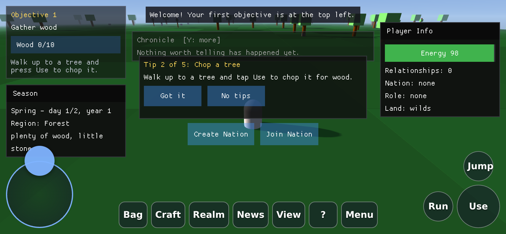

# Beyond Nations in the browser

`src/BeyondNations.Web` is the game compiled for the browser: .NET 8
`browser-wasm`, ahead-of-time compiled, with the world drawn by **Strata**,
the same engine as the desktop, built for WebGL 2 and linked into the page. It is published on
the arcade at **https://beyond-nations.play.danielstephenson.dev** and listed at
<https://danielstephenson.dev/play>.

The simulation is `BeyondNations.Core`, unchanged. The desktop host's
window-free code is compiled in from `src/BeyondNations.Desktop` as linked
source, not copied: the input layer (`InputService`, `KeyBindings`,
`PlayerInputController`, `MouseLook`, `PressLatch`), the camera and culler, the
label maths, `GameOptions` and every ImGui screen and info
box. Only what touches a window or OpenGL has a browser counterpart.

| Desktop (`BeyondNations.Desktop`) | Browser (`BeyondNations.Web`) |
| --- | --- |
| `Game` (Silk.NET window, Update/Render) | `game/WebGame.cs` (`requestAnimationFrame`) |
| `SilkInputSource` | `game/BrowserInputSource.cs` (`KeyboardEvent.code` via `game/BrowserKeys.cs`) |
| `NativeWorldRenderer` (Strata over P/Invoke) | `game/StrataWorldRenderer.cs`: the same calls, to Strata linked into `dotnet.native.wasm` (`strata/StrataWeb.cs`, `native/strata.targets`) |
| `WorldLabelRenderer` (FontStashSharp + GL) | `game/WebWorldLabelRenderer.cs` (FontStashSharp + WebGL2) |
| `UiHost` + Silk's `ImGuiController` | `game/WebUiHost.cs` + `host/ImGuiWebBackend.cs` |
| Command-line options | the URL query (`game/WebOptions.cs`) |
| `NullSoundService` (no sound) | `game/WebAudioSoundService.cs`: cues synthesised with WebAudio in `wwwroot/audio.js` |

So the browser shows what the desktop shows: Strata's sun and moon following
the time of day, its sky, cascaded shadows and fog.

## Playing

- Keyboard and mouse, as on the desktop. Hold the **right mouse button** and
  move the mouse to steer: left/right turns the player, so W walks wherever the
  drag points, and up/down tilts the camera (the page takes pointer lock for
  the drag, so the cursor does not wander).
- Text and the user interface are laid out in CSS pixels and drawn at the
  screen's `devicePixelRatio`, so they are the intended size on a high-DPI
  screen rather than shrunk, and the ImGui font is rasterised at that ratio.
- **Phones and tablets** get touch controls; see [Touch controls](#touch-controls).
- What a browser cannot do is changed rather than faked: Exit on the main menu
  shows an "exited" panel (play again, or back to the arcade); F12 downloads a
  PNG; the window size is the page's.

### Sound

The browser build has sound; the desktop does not yet (see
[SYSTEMS.md](./SYSTEMS.md#sound-feedback-and-tips-host)). `wwwroot/audio.js` is
the `bn-audio` JSImport module (`game/WebAudioSoundService.cs`): every cue is
synthesised with WebAudio oscillators and filtered noise as it plays, and the
ambient loop is looped noise through a low-pass filter with scheduled bird or
cricket chirps. No audio file is fetched. Browsers allow sound only after a
user gesture, so the `AudioContext` is created on the first `keydown`,
`pointerdown` or `touchend`; cues asked for before then are dropped and the
ambient loop starts on that gesture. Volume, mute and the tips are kept in
localStorage under `beyond-nations/feel-settings`.
`window.beyondNations.audio()` reports `locked`, `running` or `unavailable`.

### Touch controls

On a touch screen the page shows its own controls over the world, and the
game lays its screens out for a finger (`TouchLayout` in
`src/BeyondNations.Desktop/ui`, set only by the browser build):



| Control | Does |
| --- | --- |
| Joystick (bottom left) | Walk: up forward, down back; sideways turns, as A and D do, as far as it is pushed. A nearly straight push is snapped straight, so walking does not also turn |
| Drag on the world | Steer and tilt the view, like the desktop's right-drag (#309), at twice the angle per pixel, since a thumb's sweep is short |
| Tap on the world | Use whatever is within reach (a tree, rock, chicken, pawn, drop or settlement), as E does. With nothing in reach a tap does nothing, so a short look never answers "No entities within range" |
| Use, Jump, Run (bottom right) | E, Space, and Shift as a switch (tap on, tap off) |
| Bag, Craft, Realm, News, View, ?, Menu | I, C, O (nations, diplomacy and laws), Y (the chronicle: full history, hidden, recent), V, the controls list, Escape |
| HUD command bar | Tappable, and kept above the controls |

- The controls show only while the world is up, and step aside while a world
  event's bottom sheet waits for a choice (its choices are tapped directly). Every other screen has its
  own buttons: the inventory, nations and crafting screens get a large
  **Close** in the top right, the pause, main menu and settings screens use
  44-pixel buttons from the top of the screen, and the controls list
  starts with these touch controls.
- A drag on a panel (crafting, nations, inventory, the full chronicle,
  the saved worlds) scrolls it; a press is only sent when the finger lifts
  without having travelled, so a drag that starts on a button never presses
  it. A tap on a slider (the settings screen) sets it there.
- The HUD leaves the controls' band clear: the command bar and the boxes stop
  above it, the inventory box is left out (Bag opens the full list), and on a
  phone held upright the status line and chronicle go under the objective
  tracker rather than over it. Objective hints name the buttons ("press
  Use") instead of keys.
- The UI stays inside the screen's safe area (`env(safe-area-inset-*)`), clear
  of notches and rounded corners; the world still fills the whole screen.
  ImGui's widgets get more padding and ImGui's `TouchExtraPadding`.
- The page never scrolls, zooms, bounces, refreshes on a pull or opens a
  long-press menu while playing (`touch-action`, `overscroll-behavior` and a
  few listeners for what iOS Safari does regardless).
- Both orientations work. On its side the panel buttons sit between the
  joystick and the action buttons; held upright they take two rows above
  them, and a hint (once, dismissable) suggests turning the phone for a wider
  view.
- Text is laid out in CSS pixels and rasterised at the screen's
  `devicePixelRatio`, so it is as sharp as the screen.

**When they show**: the setting is *Auto*, *On* or *Off*. Auto turns the
touch layout on for a device whose main pointer is a finger, and on any
device the moment a finger touches the screen; a desktop used with a mouse
never sees it, and nothing about the desktop build changes. The setting is
on the pause screen and the settings screen (the button cycles Auto, On,
Off), is remembered in `localStorage` (`beyond-nations/touch-controls`), and
`?touch=on|off|auto` overrides it for one visit.

### URL options

The desktop's command-line options work as URL query parameters with the same
names, so `?ticks-per-second=20&seed=42&start-screen=world&debug-mode` is
`--ticks-per-second 20 --seed 42 --start-screen world --debug-mode`.

| Parameter | Meaning |
| --- | --- |
| `ticks-per-second=N` | simulation rate (default 50) |
| `seed=N` or `seed=word` | world seed: a number, or any text, hashed to one exactly as the New World screen does ([SHARING.md](./SHARING.md)); the New World screen opens with it filled in. A share link is `?seed=N`. |
| `start-screen=title\|main-menu\|config\|world\|pause\|inventory\|load\|new-world\|share` | first screen |
| `continue` | open in the most recently saved world |
| `no-saves` | do not save or offer saved worlds this run |
| `render-distance=N` | starting render distance |
| `time-of-day=F` | starting time of day, 0 to 1 |
| `stage-feel` | replay the feedback effects every 20 frames, for screenshots |
| `season=NAME` | start on the first day of `spring`, `summer`, `autumn` or `winter` |
| `debug-mode`, `first-person`, `no-labels`, `no-culling`, `render-stats` | switches (`=1`/`=true` also work; `=0`/`=false` leave them off) |
| `exit-after-frames=N`, `screenshot-after-frames=N` | for automated runs |
| `touch=on\|off\|auto` | touch controls (read by the page; see above) |

Anything unknown or malformed is dropped with a console warning. (On the
desktop a bad option ends the process; in a page that would take the runtime
down with it, so nothing unusable reaches `GameOptions.parse`.)

### Sharing

Share on the pause screen ([SHARING.md](./SHARING.md)) uses the page:
*Share link* opens the system share sheet (`navigator.share`) on a touch
device that has one and copies to the clipboard everywhere else; the replay
and history exports download, as F12's screenshot does; and the New World
screen's seed field asks with `window.prompt`, because a canvas cannot open a
phone's keyboard. The smoke test downloads both exports from the Share screen
and opens a `?seed=Ironvale` link.

### Saves

Worlds are saved to the browser's `localStorage`, under keys starting
`beyond-nations/saves/`, gzipped and base64-encoded (the arcade's games share
one origin and its roughly 5 MB of storage). The game autosaves every couple
of minutes of play, when the player leaves the world, and when the tab is
hidden. Private windows and browsers with site data turned off may not keep
them; a save that cannot be written says so on the pause screen. See
[SAVES.md](./SAVES.md).

## Usage reporting: off

The browser build sends **no usage report**. The desktop build's one `startup`
event (`telemetry/UsageReporting.cs`, see "Usage reporting" in the README) is
not compiled into it, and nothing else in the page contacts trace or any other
service: the page only fetches its own files.

Why off rather than the desktop's disclosed opt-out: the arcade already counts
page loads for every game, without cookies or identifiers, so a second count
would add nothing; a browser has no `settings.json`, console line or
environment variable through which the desktop's notice and one-step opt-out
are given, and a substitute would have to be a cookie banner; and a trace
write key compiled into a public page would be anyone's to use.

## Building

```bash
dotnet workload install wasm-tools        # once; brings the Emscripten the build needs
dotnet publish src/BeyondNations.Web/BeyondNations.Web.csproj -c Release -o web-publish
python3 -m http.server 8080 --directory web-publish/wwwroot
# open http://localhost:8080/?seed=42
```

`src/BeyondNations.Web/global.json` selects a .NET 8 SDK for that directory
(the workload is per SDK band; with a newer SDK it would be `wasm-tools-net8`),
so run the workload install and the publish from there if newer SDKs are
installed.

`BeyondNations.Web` is deliberately **not** in `BeyondNations.sln`, so
`dotnet build` and `dotnet test` on the solution still need nothing but the .NET
SDK. Its plain-C# parts (the URL options, the key table and the browser input
source) are covered by `tests/BeyondNations.Web.Tests`, which is in the solution
and runs in `Build and test`.

- **Strata**: `native/strata.targets` pins a Strata commit (its browser
  build has no release yet), checks the source tarball's SHA-256 and runs
  `native/build-strata.sh`, which builds it with the **workload's own
  Emscripten (3.1.34)**, not the newer one Strata's CI uses, so the objects
  link with .NET's `wasm-ld`; with `-DSTRATA_WITH_SDL=OFF` (the page owns
  the canvas) and `-DSTRATA_WASM_EXCEPTIONS=wasm` (the mode .NET 8 links the
  module with). It needs CMake 3.24 or newer (`STRATA_CMAKE=/path/to/cmake`
  if the one on PATH is older). The archive is linked as `strata.a`, the name
  `[DllImport("strata")]` resolves to. `native/bnweb_gl.c` makes the
  canvas's WebGL 2 context known to Emscripten, which Strata's
  `STRATA_SURFACE_HOST_CONTEXT` requires; the labels and Dear ImGui are then
  drawn by `webhost/gfx.js` in the same context.
- **AOT**: on by default for publish. With the WebGL2 renderer used before Strata the
  AOT build spent 2 to 4 ms of main-thread time a frame at the 95th
  percentile on a seed-42 walk, the interpreter 6 to 12 ms. With Strata,
  headless Chromium's software GPU (SwiftShader) is the bottleneck (about 9
  fps at 1280x720 with Strata's default four 2048-pixel shadow cascades,
  AOT or not), so frame times measured there say nothing about a real GPU.
  `/p:RunAOTCompilation=false` builds the interpreter version in about half
  the time, which is handy when only the page is changing.
- **Size**: the first load is about 3.6 MB (the runtime and assemblies are
  fetched gzip-compressed and inflated in the browser by
  `webhost/loader.js`, because the arcade serves files as they are).
- **cimgui**: ImGui.NET's native half has no browser build, so
  `native/cimgui.targets` downloads the exact cimgui and Dear ImGui commits
  ImGui.NET 1.90.8.1 was built from (pinned by SHA-256), compiles them with the
  workload's Emscripten and links them into `dotnet.native.wasm`.
  Its printf-style functions cannot be called from here; see the next section.
- `WasmStripILAfterAOT` stays off: with it, .NET 8's runtime fails to start
  this app. If an AOT publish ever fails at start-up with an interpreter
  assertion, delete `src/BeyondNations.Web/obj` and `bin` first: incremental
  AOT builds after a settings change have produced a broken runtime here.

### Variadic ImGui functions

Don't call `ImGui.TextColored`, `ImGui.Text`, `ImGui.TextWrapped`,
`ImGui.TextDisabled`, `ImGui.BulletText`, `ImGui.LabelText`,
`ImGui.SetTooltip`, `ImGui.SetItemTooltip` or `ImGui.LogText` in code the
browser build compiles. That covers every screen under
`src/BeyondNations.Desktop/ui`.
Their C functions are variadic (`igTextColored(ImVec4 col, const char* fmt, ...)`),
but ImGui.NET P/Invokes them with a fixed argument list (`(Vector4, byte*)`).
On x64 the extra argument is simply never read. On WebAssembly a variadic
function's signature has an extra parameter, a pointer to the varargs buffer,
so the call fails the signature check. The first frame that reaches it ends the
page with `RuntimeError: null function or function signature mismatch`, and the
stack has no managed frames to show where.

Use these instead:

- `Overlay.textColoured(colour, text)` in place of `TextColored`;
- `ImGui.TextUnformatted(text)` in place of `Text`;
- `TextWrap.wrap` with one `TextUnformatted` per line, or
  `ImGui.PushTextWrapPos(0f)`, then `TextUnformatted`, then `PopTextWrapPos()`,
  in place of `TextWrapped`.

Calls with a fixed signature are fine, even ones that pass a struct by value.
`PushTextWrapPos`, `ProgressBar`, `PushStyleColor` (either overload),
`SetNextWindowBgAlpha`, `BeginChild`, `GetScrollY` and `SetScrollHereY` all
work in the browser. They were checked with the objective tracker and the full
chronicle view. `TestNoVariadicImGuiCalls` (in
`tests/BeyondNations.Desktop.Tests`) fails the desktop build if a variadic call
appears in the shared source.

To name the function behind any wasm trap, publish with a symbol map:
`dotnet publish ... -p:WasmEmitSymbolMap=true -p:WasmNativeStrip=false`. The
browser's stack trace then names each frame. For this trap the top frame was
`aot_wrapper_..._ImGuiNative__igTextColored_pinvoke_void_cls11_Numerics_dVector4_cl7_byte_2a_`.

## Tests

`.github/workflows/browser.yml` publishes the site, then
`src/BeyondNations.Web/smoke/smoke.mjs` drives it in headless Chromium
(Playwright, WebGL2 on SwiftShader):

- desktop profile: the title screen appears, a key opens the main menu, Start
  builds a world, the world is drawn (pixels sampled from the frame, not the
  clear colour), W walks, a right-drag steers (the player turns exactly 9
  degrees and the camera tilts 1.5 for a 60 by 10 pixel drag, with no camera
  yaw offset) and a plain move does not (#291), the first tip of a new world
  shows (`hint` in the status is `move`), a key
  tap shorter than a frame toggles the view (#290), and there are no console
  errors, page errors or failed requests;
- phone profiles, held upright (390x844) and on its side (844x390), with
  touch: no controls over the title, a tap leaves it, Start is tapped, the
  touch layout comes up with its band reported to the game (and, upright,
  the rotate hint, dismissed by a tap); the joystick pushed up walks the
  player without turning and pushed right turns them right; a 60 pixel drag
  on the world turns the player exactly 18 degrees; a tap on the world with
  nothing in reach does nothing; Bag, Craft and Realm open their panels,
  the controls step aside and the corner Close brings the world back; a drag
  on the crafting list scrolls it; News cycles the chronicle; ? opens the
  controls list; Menu pauses and the touch Resume resumes; the first tip shows; and the
  page has neither scrolled nor zoomed. On its side, a staged world event
  (`?stage-event`) hides the controls until a tap on a choice answers it.

Screenshots and the console log are uploaded as the `web-smoke` artifact.

```bash
cd src/BeyondNations.Web/smoke && npm ci && npx playwright install chromium
node smoke.mjs http://localhost:8080/ out            # desktop
node smoke.mjs http://localhost:8080/ out --phone              # phone, upright
node smoke.mjs http://localhost:8080/ out --phone-landscape    # phone, on its side
```

`window.beyondNations.status()` in the browser console shows the same summary
the test reads (screen, frames, what was drawn, look angles, camera mode).

## Deploying

On a push to `develop`, when the repository variable `ARCADE_ENABLED` is
`true`, the same workflow uploads the site to the arcade with
`Stephenson-Software/arcade-deploy` as version `<GameVersion>+g<sha>` (the
`ARCADE_TOKEN` secret is the game's upload token; the slug `beyond-nations` is
registered in the gateway's `config/arcade/games.yaml`). `workflow_dispatch`
deploys by hand.

## The web host, for other games

`wwwroot/webhost/` and `host/` know nothing about Beyond Nations, so another
.NET game of the Strata family can reuse them:

- `webhost/host.js`: `startWebHost({ canvas, ui, assembly, exportsName, modules })`
  boots the runtime, registers the `webhost` JSImport module (and any of the
  game's own, such as Beyond Nations' `bn-audio`), forwards input and runs
  the frame clock;
- `webhost/gfx.js`: the WebGL2 passes drawn over the engine's world
  (textured labels, Dear ImGui draw lists), driven by pointers into wasm
  memory so frame data is never copied through interop;
- `webhost/input.js`, `canvas.js`, `loader.js`, `touch.js`: keyboard by
  `KeyboardEvent.code`, right-drag pointer-lock look and touch drags (look,
  scroll or pointer, as the page decides), `devicePixelRatio`-aware sizing,
  the gzip loader, the joystick, key buttons, safe-area insets and gesture
  blocking;
- `host/WebHost.cs`: the C# side (`WebGpu`, `WebPage`, the `IWebGame` a game
  implements, the `[JSExport]`s); `host/ImGuiWebBackend.cs`: Dear ImGui for the
  browser.

A game supplies an `IWebGame` and its page, and links Strata the way
`native/strata.targets` and `native/bnweb_gl.c` do here.
